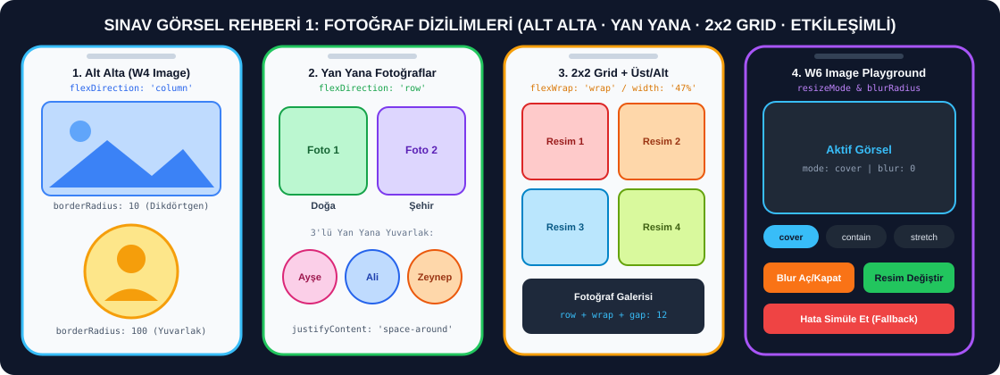

# 📸 Fotoğraf Dizilimleri (Yan Yana, Alt Alta, Grid, Yuvarlak) ve Image Senaryoları

> **[⬅️ Ana Sınav Rehberine (README) Dön](./README.md)**



---

## 📌 Bu Dosya Hangi Hafta ve Hangi Ders Kodlarına Karşılık Gelir?

| Hafta | Ders Notu Dosyası ve Konu Başlığı | Hocanın Kodundaki Bileşen Adı | Ne İşe Yarar? |
| :--- | :--- | :--- | :--- |
| **Hafta 4 (W4)** | `W4 / 7-example-basic-components.md` — **3. Image - Image Component** | `ImageExamples` | Üstte dikdörtgen (`borderRadius: 10`), altta tam daire (`borderRadius: 100`) iki fotoğrafı alt alta gösterir. |
| **Hafta 4 (W4)** | `W4 / 7-example-basic-components.md` — **1. View - Container Component** | `BasicView` | `flexDirection: 'row'` ve `justifyContent: 'space-around'` ile 3 elemanı yan yana dizer. |
| **Hafta 6 (W6)** | `W6 / components / Image.md` — **Example 1: News Card with Loading Feedback** | `NewsCard` | Üst kısmı fotoğraflı, alt kısmı başlıklı ve açıklamalı haber kartı; resim yüklenirken dönen ikon (`ActivityIndicator`) gösterir. |
| **Hafta 6 (W6)** | `W6 / components / Image.md` — **Example 2: Image Playground** | `ImagePlayground` | Butonlarla fotoğrafın sığdırma modunu (`cover`, `contain`, `stretch`, `center`, `repeat`), bulanıklığını (`blurRadius`) ve yedek resmini (`FALLBACK_URI`) değiştirir. |
| **Hafta 6 (W6)** | `W6 / components / View.md` — **Example 2: Responsive Grid with onLayout** | `ResponsiveGrid` | `flexDirection: 'row'` ve `flexWrap: 'wrap'` kullanarak elemanları çoklu satır/sütun ızgara (grid) şeklinde dizer. |

---

## ⚡ Sınavda Hoca Fotoğraflarla İlgili Bir Değişiklik İsterse Nereyi Değiştireceksin?

| Hocanın Görselde İstediği Değişiklik | Hangi Stil / Prop Değişecek? | Yazacağın Kod Karşılığı |
| :--- | :--- | :--- |
| Fotoğrafları **Yan Yana** dizmek | Fotoğrafları saran `View` stilinde | `flexDirection: 'row'`, `justifyContent: 'space-around'`, `alignItems: 'center'` |
| Fotoğrafları **Alt Alta** dizmek | Fotoğrafları saran `View` stilinde | `flexDirection: 'column'`, `alignItems: 'center'` |
| Fotoğrafları **2x2 Izgara (Grid)** yapmak | Kapsayıcı `View` ve `Image` stilinde | Kapsayıcıda: `flexDirection: 'row', flexWrap: 'wrap', justifyContent: 'space-between'` — Resimde: `width: '48%'` |
| Kare fotoğrafı **Tam Yuvarlak (Daire)** yapmak | `Image` stilinde (`style`) | `width: 120, height: 120, borderRadius: 60` (`borderRadius` değeri genişliğin tam yarısı olmalı!) |
| Fotoğrafın köşelerini **Hafif Yuvarlatmak** | `Image` stilinde (`style`) | `borderRadius: 12` veya `borderRadius: 20` |
| Fotoğrafa **Renkli Çerçeve** eklemek | `Image` stilinde (`style`) | `borderWidth: 3, borderColor: '#2563eb'` |
| Fotoğrafı **Bulanıklaştırmak (Blur)** | `Image` bileşen prop'unda | `blurRadius={15}` (0 olursa net, sayı büyüdükçe bulanık) |
| Fotoğrafı kutuya **Tam Doldurmak (Kırparak)** | `Image` bileşen prop'unda | `resizeMode="cover"` |
| Fotoğrafın **Tamamını Sığdırmak (Kırpmadan)** | `Image` bileşen prop'unda | `resizeMode="contain"` |
| Fotoğrafı kutuya **Sündürerek Yaymak** | `Image` bileşen prop'unda | `resizeMode="stretch"` |
| İnternetten **Fotoğraf Linki** değiştirmek | `Image` bileşen prop'unda | `source={{ uri: 'https://picsum.photos/300/200' }}` |

---

## 1️⃣ HAFTA 4 (W4) — Hocanın Orijinal Alt Alta Dikdörtgen ve Yuvarlak Fotoğraf Kodu

* **Hafta ve Konu Başlığı:** Hafta 4 (W4) · `7-example-basic-components.md` · **3. Image - Image Component (`ImageExamples`)**
* **Bu Kod Ne İşe Yarar?**
  * Ekran genişliğini `Dimensions.get('window')` ile alır.
  * Üstte ekran genişliğine yayılan (`width - 40`), yüksekliği `200` olan ve köşeleri hafif yuvarlatılmış (`borderRadius: 10`) dikdörtgen bir fotoğraf gösterir.
  * Altta ise genişliği `200`, yüksekliği `200` ve `borderRadius: 100` (yarıçapı genişliğin yarısı olduğu için tam daire) olan yuvarlak bir fotoğraf gösterir.
* **Sınavda Nasıl Değiştirilir?**
  * İki fotoğrafı yan yana koymak istersen `container` stiline `flexDirection: 'row'` ekleyip üstteki resmin `width` değerini `150` yapman yeterlidir.

```jsx
import React from 'react';
import { Image, View, StyleSheet, Dimensions } from 'react-native';

const { width } = Dimensions.get('window');

export default function ImageExamples() {
  return (
    <View style={styles.container}>
      <Image
        source={{ uri: 'https://picsum.photos/300/200' }}
        style={styles.image}
        resizeMode="cover"
      />
      <Image
        source={{ uri: 'https://picsum.photos/200/200' }}
        style={styles.squareImage}
        resizeMode="contain"
      />
    </View>
  );
}

const styles = StyleSheet.create({
  container: {
    flex: 1,
    padding: 20,
    justifyContent: 'center',
    alignItems: 'center',
  },
  image: {
    width: width - 40,
    height: 200,
    borderRadius: 10,
    marginBottom: 20,
  },
  squareImage: {
    width: 200,
    height: 200,
    borderRadius: 100,
  },
});
```

---

## 2️⃣ HAFTA 4 (W4) — Hocanın Yan Yana 3 Kutu Dizilimi Kodu (`BasicView`)

* **Hafta ve Konu Başlığı:** Hafta 4 (W4) · `7-example-basic-components.md` · **1. View - Container Component (`BasicView`)**
* **Bu Kod Ne İşe Yarar?**
  * `flexDirection: 'row'` ve `justifyContent: 'space-around'` kullanarak kırmızı (`#ff6b6b`), turkuaz (`#4ecdc4`) ve mavi (`#45b7d1`) üç kutuyu ekranın ortasında yan yana eşit boşluklarla dizer.
* **Sınavda Nasıl Değiştirilir?**
  * Hoca kutular yerine yan yana 3 fotoğraf isterse `<View style={styles.box1} />` satırlarının yerine `<Image source={{ uri: '...' }} style={styles.box1} />` yazman yeterlidir!

```jsx
import React from 'react';
import { View, StyleSheet } from 'react-native';

export default function BasicView() {
  return (
    <View style={styles.container}>
      <View style={styles.box1} />
      <View style={styles.box2} />
      <View style={styles.box3} />
    </View>
  );
}

const styles = StyleSheet.create({
  container: {
    flex: 1,
    flexDirection: 'row',
    justifyContent: 'space-around',
    alignItems: 'center',
    backgroundColor: '#f0f0f0',
  },
  box1: {
    width: 50,
    height: 50,
    backgroundColor: '#ff6b6b',
  },
  box2: {
    width: 50,
    height: 50,
    backgroundColor: '#4ecdc4',
  },
  box3: {
    width: 50,
    height: 50,
    backgroundColor: '#45b7d1',
  },
});
```

---

## 3️⃣ SINAV SENARYOSU 1A — Yan Yana ve Alt Alta Fotoğraflar + Altında İsimleri (Tek Ekranda Karşılaştırmalı)

* **İlgili Ders Konusu:** Hafta 4 (`BasicView` + `ImageExamples`) ve Hafta 6 (`View.md` + `Image.md`)
* **Bu Kod Ne İşe Yarar?**
  * Ekranın üst bölümünde **2 kare fotoğrafı yan yana** (`flexDirection: 'row'`) ve her fotoğrafın hemen altında kendi başlığını gösterir.
  * Orta bölümde **3 yuvarlak profil fotoğrafını yan yana** (`borderRadius: 45`, `width: 90, height: 90`) ve altında kişi isimlerini gösterir.
  * Alt bölümde ise **Buton ile Dizilim Değiştirme** özelliği vardır: Butona bastıkça fotoğrafları **Yan Yana (`row`)** veya **Alt Alta (`column`)** olarak anında değiştirir!

```jsx
import React, { useState } from 'react';
import { SafeAreaView, ScrollView, View, Text, Image, TouchableOpacity, StyleSheet } from 'react-native';

const PROFILES = [
  { id: '1', name: 'Ayşe', role: 'Tasarımcı', color: '#ec4899', uri: 'https://picsum.photos/id/64/200/200' },
  { id: '2', name: 'Ahmet', role: 'Geliştirici', color: '#2563eb', uri: 'https://picsum.photos/id/91/200/200' },
  { id: '3', name: 'Zeynep', role: 'Yönetici', color: '#16a34a', uri: 'https://picsum.photos/id/177/200/200' },
];

export default function SideBySideAndStackedImages() {
  const [isRow, setIsRow] = useState(true);

  return (
    <SafeAreaView style={styles.safeArea}>
      <ScrollView contentContainerStyle={styles.scrollContent}>
        <Text style={styles.mainTitle}>Fotoğraf Dizilim Senaryoları</Text>

        <TouchableOpacity
          style={[styles.toggleButton, { backgroundColor: isRow ? '#2563eb' : '#9333ea' }]}
          onPress={() => setIsRow(!isRow)}
        >
          <Text style={styles.toggleButtonText}>
            Şu Anki Dizilim: {isRow ? 'YAN YANA (row)' : 'ALT ALTA (column)'} — Değiştir
          </Text>
        </TouchableOpacity>

        <Text style={styles.sectionTitle}>1. İki Fotoğraf ({isRow ? 'Yan Yana' : 'Alt Alta'})</Text>
        <View style={[styles.photoGroup, { flexDirection: isRow ? 'row' : 'column' }]}>
          <View style={styles.photoCard}>
            <Image
              source={{ uri: 'https://picsum.photos/id/1015/300/200' }}
              style={styles.rectImage}
              resizeMode="cover"
            />
            <Text style={styles.photoLabel}>Doğa Manzarası</Text>
          </View>

          <View style={styles.photoCard}>
            <Image
              source={{ uri: 'https://picsum.photos/id/1011/300/200' }}
              style={styles.rectImage}
              resizeMode="cover"
            />
            <Text style={styles.photoLabel}>Göl Manzarası</Text>
          </View>
        </View>

        <Text style={styles.sectionTitle}>2. Üç Yuvarlak Profil Fotoğrafı ({isRow ? 'Yan Yana' : 'Alt Alta'})</Text>
        <View style={[styles.photoGroup, { flexDirection: isRow ? 'row' : 'column' }]}>
          {PROFILES.map((person) => (
            <View key={person.id} style={styles.avatarContainer}>
              <Image
                source={{ uri: person.uri }}
                style={[styles.circleImage, { borderColor: person.color }]}
              />
              <Text style={[styles.personName, { color: person.color }]}>{person.name}</Text>
              <Text style={styles.personRole}>{person.role}</Text>
            </View>
          ))}
        </View>
      </ScrollView>
    </SafeAreaView>
  );
}

const styles = StyleSheet.create({
  safeArea: {
    flex: 1,
    backgroundColor: '#f8fafc',
  },
  scrollContent: {
    padding: 20,
  },
  mainTitle: {
    fontSize: 22,
    fontWeight: 'bold',
    color: '#0f172a',
    textAlign: 'center',
    marginBottom: 16,
  },
  toggleButton: {
    paddingVertical: 14,
    paddingHorizontal: 16,
    borderRadius: 12,
    alignItems: 'center',
    marginBottom: 24,
  },
  toggleButtonText: {
    color: '#ffffff',
    fontSize: 14,
    fontWeight: 'bold',
  },
  sectionTitle: {
    fontSize: 17,
    fontWeight: '700',
    color: '#1e293b',
    marginBottom: 12,
  },
  photoGroup: {
    justifyContent: 'space-around',
    alignItems: 'center',
    backgroundColor: '#ffffff',
    padding: 16,
    borderRadius: 16,
    marginBottom: 24,
    gap: 16,
    borderWidth: 1,
    borderColor: '#e2e8f0',
  },
  photoCard: {
    alignItems: 'center',
  },
  rectImage: {
    width: 140,
    height: 100,
    borderRadius: 12,
    marginBottom: 8,
  },
  photoLabel: {
    fontSize: 14,
    fontWeight: '600',
    color: '#334155',
  },
  avatarContainer: {
    alignItems: 'center',
  },
  circleImage: {
    width: 84,
    height: 84,
    borderRadius: 42,
    borderWidth: 3,
    marginBottom: 6,
  },
  personName: {
    fontSize: 15,
    fontWeight: 'bold',
  },
  personRole: {
    fontSize: 12,
    color: '#64748b',
  },
});
```

---

## 4️⃣ SINAV SENARYOSU 1B — 2x2 Izgara (Grid) Fotoğraf Galerisi + Üstte 1 Büyük Altta 2 Küçük Fotoğraf

* **İlgili Ders Konusu:** Hafta 6 (`W6 / View.md` — `ResponsiveGrid` ve `W6 / Image.md`)
* **Bu Kod Ne İşe Yarar?**
  * Üstte **1 büyük seçili fotoğraf** gösterir.
  * Onun altında **2x2 Izgara (4 adet fotoğraf)** yan yana ve alt alta (`flexDirection: 'row'`, `flexWrap: 'wrap'`, `width: '48%'`) dizilidir.
  * Küçük fotoğraflardan hangisine tıklarsan üstteki büyük fotoğraf ve başlığı anında o fotoğrafa dönüşür, seçili küçük fotoğrafın çerçevesi mavi (`#2563eb`) olur!

```jsx
import React, { useState } from 'react';
import { SafeAreaView, ScrollView, View, Text, Image, TouchableOpacity, StyleSheet } from 'react-native';

const GALLERY = [
  { id: '1', title: 'Dağ Evi', uri: 'https://picsum.photos/id/1018/600/400' },
  { id: '2', title: 'Orman Yolu', uri: 'https://picsum.photos/id/1015/600/400' },
  { id: '3', title: 'Deniz Kıyısı', uri: 'https://picsum.photos/id/1016/600/400' },
  { id: '4', title: 'Şehir Işıkları', uri: 'https://picsum.photos/id/1025/600/400' },
];

export default function PhotoGridGallery() {
  const [selectedPhoto, setSelectedPhoto] = useState(GALLERY[0]);

  return (
    <SafeAreaView style={styles.container}>
      <ScrollView contentContainerStyle={styles.content}>
        <Text style={styles.headerTitle}>Seçili Fotoğraf: {selectedPhoto.title}</Text>

        <View style={styles.featuredWrapper}>
          <Image
            source={{ uri: selectedPhoto.uri }}
            style={styles.featuredImage}
            resizeMode="cover"
          />
        </View>

        <Text style={styles.subHeader}>2x2 Fotoğraf Izgarası (Seçmek İçin Dokun)</Text>

        <View style={styles.gridContainer}>
          {GALLERY.map((item) => {
            const isSelected = item.id === selectedPhoto.id;
            return (
              <TouchableOpacity
                key={item.id}
                style={[
                  styles.gridCard,
                  { borderColor: isSelected ? '#2563eb' : '#e2e8f0' },
                ]}
                onPress={() => setSelectedPhoto(item)}
                activeOpacity={0.8}
              >
                <Image
                  source={{ uri: item.uri }}
                  style={styles.gridImage}
                  resizeMode="cover"
                />
                <Text
                  style={[
                    styles.gridLabel,
                    { color: isSelected ? '#2563eb' : '#334155' },
                  ]}
                >
                  {item.title}
                </Text>
              </TouchableOpacity>
            );
          })}
        </View>
      </ScrollView>
    </SafeAreaView>
  );
}

const styles = StyleSheet.create({
  container: {
    flex: 1,
    backgroundColor: '#f8fafc',
  },
  content: {
    padding: 20,
  },
  headerTitle: {
    fontSize: 20,
    fontWeight: 'bold',
    color: '#0f172a',
    marginBottom: 12,
    textAlign: 'center',
  },
  featuredWrapper: {
    height: 200,
    borderRadius: 16,
    overflow: 'hidden',
    marginBottom: 20,
    borderWidth: 3,
    borderColor: '#2563eb',
  },
  featuredImage: {
    width: '100%',
    height: '100%',
  },
  subHeader: {
    fontSize: 16,
    fontWeight: '600',
    color: '#475569',
    marginBottom: 12,
  },
  gridContainer: {
    flexDirection: 'row',
    flexWrap: 'wrap',
    justifyContent: 'space-between',
    gap: 12,
  },
  gridCard: {
    width: '48%',
    backgroundColor: '#ffffff',
    borderRadius: 12,
    padding: 8,
    borderWidth: 2,
    alignItems: 'center',
  },
  gridImage: {
    width: '100%',
    height: 100,
    borderRadius: 8,
    marginBottom: 6,
  },
  gridLabel: {
    fontSize: 14,
    fontWeight: '600',
  },
});
```

---

## 5️⃣ HAFTA 6 (W6) — Hocanın Orijinal Haber Kartı Kodu (`NewsCard`)

* **Hafta ve Konu Başlığı:** Hafta 6 (W6) · `W6 / components / Image.md` · **Example 1: News Card with Loading Feedback (`NewsCard`)**
* **Bu Kod Ne İşe Yarar?**
  * Beyaz gölgeli bir kartın üst kısmında (`height: 200`) internetten çekilen bir fotoğraf, alt kısmında ise kalın başlık (`New React Native Course Launch`) ve açıklama metni gösterir.
  * Fotoğraf yüklenirken `onLoadStart` ile `loading` durumunu `true` yapar ve mavi dönen yükleme ikonu (`ActivityIndicator`) gösterir; yükleme bitince (`onLoad`) ikonu gizler; hata olursa (`onError`) `"Image failed to load"` yazar.

```jsx
import React, { useState } from 'react';
import {
  ActivityIndicator,
  Image,
  SafeAreaView,
  StyleSheet,
  Text,
  View,
} from 'react-native';

export default function NewsCard() {
  const [loading, setLoading] = useState(true);
  const [error, setError] = useState(false);

  return (
    <SafeAreaView style={{ flex: 1, backgroundColor: '#f8fafc' }}>
      <View style={{ flex: 1, justifyContent: 'center', padding: 24 }}>
        <View
          style={{
            borderRadius: 20,
            backgroundColor: '#fff',
            shadowColor: '#000',
            shadowOpacity: 0.08,
            shadowRadius: 12,
            elevation: 3,
          }}
        >
          <View
            style={{
              height: 200,
              overflow: 'hidden',
              borderTopLeftRadius: 20,
              borderTopRightRadius: 20,
            }}
          >
            {loading && !error && (
              <View
                style={{
                  ...StyleSheet.absoluteFillObject,
                  justifyContent: 'center',
                  alignItems: 'center',
                  backgroundColor: '#e2e8f0',
                }}
              >
                <ActivityIndicator color="#2563eb" />
              </View>
            )}
            {error && (
              <View
                style={{
                  ...StyleSheet.absoluteFillObject,
                  justifyContent: 'center',
                  alignItems: 'center',
                  backgroundColor: '#e2e8f0',
                }}
              >
                <Text>Image failed to load</Text>
              </View>
            )}
            <Image
              source={{ uri: 'https://picsum.photos/600/400' }}
              style={{ width: '100%', height: '100%' }}
              onLoadStart={() => {
                setLoading(true);
                setError(false);
              }}
              onLoad={() => setLoading(false)}
              onError={() => {
                setLoading(false);
                setError(true);
              }}
            />
          </View>
          <View style={{ padding: 20, gap: 8 }}>
            <Text style={{ fontSize: 18, fontWeight: '600', color: '#111827' }}>
              New React Native Course Launch
            </Text>
            <Text style={{ color: '#475569', lineHeight: 20 }}>
              The latest series covers everything from core components to performance
              optimization, all built with Expo.
            </Text>
          </View>
        </View>
      </View>
    </SafeAreaView>
  );
}
```

---

## 6️⃣ HAFTA 6 (W6) — Hocanın Orijinal Etkileşimli Image Playground Kodu (`ImagePlayground`)

* **Hafta ve Konu Başlığı:** Hafta 6 (W6) · `W6 / components / Image.md` · **Example 2: Image Playground (`ImagePlayground`)**
* **Bu Kod Ne İşe Yarar?**
  * Fotoğrafın altında yer alan yuvarlak hap butonlarla (`MODES.map`) `resizeMode` özelliğini `cover`, `contain`, `stretch`, `center`, `repeat` arasında canlı olarak değiştirir.
  * **Enable blur / Disable blur** butonuyla `blurRadius` değerini `18` ile `0` arasında değiştirir (buton rengi aktifken turuncu `#f97316`, pasifken koyu gri `#1e293b` olur).
  * **Simulate failure** (kırmızı `#ef4444` buton) bozuk bir URL vererek `onError` tetikler ve otomatik olarak yedek resmi (`FALLBACK_URI`) yükler.
  * **Back to original** (yeşil `#22c55e` buton) tekrar ana fotoğrafa (`PRIMARY_URI`) döner.

```jsx
import React, { useMemo, useState } from 'react';
import {
  ActivityIndicator,
  Image,
  SafeAreaView,
  Text,
  TouchableOpacity,
  View,
} from 'react-native';

const PRIMARY_URI = 'https://images.unsplash.com/photo-1521572267360-ee0c2909d518';
const FALLBACK_URI =
  'https://ui-avatars.com/api/?background=2563eb&color=fff&name=React+Native';
const MODES = ['cover', 'contain', 'stretch', 'center', 'repeat'];

export default function ImagePlayground() {
  const [uri, setUri] = useState(PRIMARY_URI);
  const [status, setStatus] = useState('Ready');
  const [resizeMode, setResizeMode] = useState(MODES[0]);
  const [blurEnabled, setBlurEnabled] = useState(false);

  const infoText = useMemo(() => {
    switch (status) {
      case 'loading':
        return 'Image is loading...';
      case 'loaded':
        return 'Image loaded successfully.';
      case 'fallback':
        return 'Primary source failed, showing fallback image.';
      default:
        return 'Ready.';
    }
  }, [status]);

  const triggerError = () => {
    setStatus('loading');
    setUri('https://invalid-url.example.com/image.jpg');
  };

  const enablePrimary = () => {
    setStatus('loading');
    setUri(PRIMARY_URI);
  };

  return (
    <SafeAreaView style={{ flex: 1, backgroundColor: '#0f172a' }}>
      <View
        style={{
          flex: 1,
          padding: 24,
          justifyContent: 'center',
          gap: 16,
        }}
      >
        <Text style={{ color: '#f8fafc', fontSize: 22, fontWeight: '700' }}>
          Image playground
        </Text>
        <Text style={{ color: '#94a3b8' }}>
          Active resizeMode: <Text style={{ fontWeight: '700' }}>{resizeMode}</Text> ·
          blurRadius: {blurEnabled ? 18 : 0}
        </Text>

        <View
          style={{
            height: 220,
            borderRadius: 20,
            backgroundColor: '#1f2937',
            overflow: 'hidden',
            justifyContent: 'center',
            alignItems: 'center',
          }}
        >
          {status === 'loading' && (
            <ActivityIndicator color="#38bdf8" size="large" />
          )}
          <Image
            source={{ uri }}
            style={{ width: '100%', height: '100%' }}
            resizeMode={resizeMode}
            blurRadius={blurEnabled ? 18 : 0}
            onLoadStart={() => setStatus('loading')}
            onLoad={() => setStatus('loaded')}
            onError={() => {
              setStatus('fallback');
              setUri(FALLBACK_URI);
            }}
          />
        </View>

        <Text style={{ color: '#e2e8f0' }}>{infoText}</Text>

        <View style={{ flexDirection: 'row', flexWrap: 'wrap', gap: 8 }}>
          {MODES.map((mode) => {
            const isActive = mode === resizeMode;
            return (
              <TouchableOpacity
                key={mode}
                onPress={() => setResizeMode(mode)}
                style={{
                  paddingVertical: 10,
                  paddingHorizontal: 14,
                  borderRadius: 999,
                  backgroundColor: isActive ? '#38bdf8' : '#1f2937',
                }}
              >
                <Text style={{ color: isActive ? '#0f172a' : '#e2e8f0' }}>
                  {mode}
                </Text>
              </TouchableOpacity>
            );
          })}
        </View>

        <View style={{ flexDirection: 'row', flexWrap: 'wrap', gap: 12 }}>
          <TouchableOpacity
            onPress={() => setBlurEnabled((prev) => !prev)}
            style={{
              paddingVertical: 12,
              paddingHorizontal: 16,
              borderRadius: 12,
              backgroundColor: blurEnabled ? '#f97316' : '#1e293b',
            }}
          >
            <Text style={{ color: '#f8fafc', fontWeight: '600' }}>
              {blurEnabled ? 'Disable blur' : 'Enable blur'}
            </Text>
          </TouchableOpacity>

          <TouchableOpacity
            onPress={triggerError}
            style={{
              paddingVertical: 12,
              paddingHorizontal: 16,
              borderRadius: 12,
              backgroundColor: '#ef4444',
            }}
          >
            <Text style={{ color: '#fff', fontWeight: '600' }}>
              Simulate failure
            </Text>
          </TouchableOpacity>

          <TouchableOpacity
            onPress={enablePrimary}
            style={{
              paddingVertical: 12,
              paddingHorizontal: 16,
              borderRadius: 12,
              backgroundColor: '#22c55e',
            }}
          >
            <Text style={{ color: '#0f172a', fontWeight: '600' }}>
              Back to original
            </Text>
          </TouchableOpacity>
        </View>
      </View>
    </SafeAreaView>
  );
}
```
