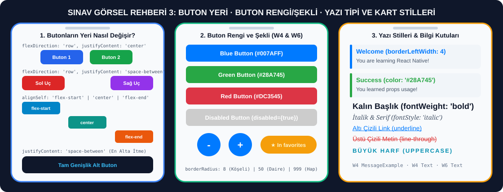

# 🎨 Buton Rengi, Buton Yeri, Yazı Tipi, Yazı Değiştirme ve Yeni Eleman Ekleme Rehberi

> **[⬅️ Ana Sınav Rehberine (README) Dön](./README.md)**



---

## 📌 Bu Dosya Hangi Hafta ve Hangi Ders Kodlarına Karşılık Gelir?

| Hafta | Ders Notu Dosyası ve Konu Başlığı | Hocanın Kodundaki Bileşen Adı | Ne İşe Yarar? |
| :--- | :--- | :--- | :--- |
| **Hafta 4 (W4)** | `W4 / 4-react-native-props.md` — **Example 2: Button Component** | `ButtonExample` & `CustomButton` | Props ile mavi (`#007AFF`), yeşil (`#28A745`), kırmızı (`#DC3545`) ve pasif (`disabled={true}`, gri `#ccc`) butonlar oluşturur. |
| **Hafta 4 (W4)** | `W4 / 4-react-native-props.md` — **Example 1: Simple Message Component** | `MessageExample` & `Message` | Sol kenarı çizgili (`borderLeftWidth: 4`) bilgi kartlarına başlık, mesaj ve renk (`color`) prop'u gönderir. |
| **Hafta 4 (W4)** | `W4 / 3-react-native-variable-const.md` — **Example 1: Simple Variable Usage** | `VariableExample` | `const` ve `let` değişkenlerini sol kenarı mavi çizgili (`borderLeftColor: '#007AFF'`) kutularda gösterir. |
| **Hafta 4 (W4)** | `W4 / 7-example-basic-components.md` — **2. Text - Text Component** | `TextExamples` | Başlık, alt başlık, paragraf, altı çizili link ve kırmızı hata mesajı stillerini gösterir. |
| **Hafta 6 (W6)** | `W6 / components / Text.md` — **Example 1: Rich Text Banner Showcasing Props** | `RichTextBanner` | Büyük harf (`uppercase`), harf aralığı (`letterSpacing: 2`), satır sınırı (`numberOfLines={2}`), iç içe `Text` ve tıklanabilir altı çizili link (`Linking.openURL`) gösterir. |
| **Hafta 6 (W6)** | `W6 / components / TouchableOpacity.md` — **Example 1: Favorite Course Card** | `CourseCard` | Butona tıklandıkça yıldız ikonunu (`star` / `star-outline`), buton rengini (`#f59e0b` / `#334155`) ve buton yazısını değiştirir. |
| **Hafta 3 (W3)** | `W3 / 12-styling-example.jsx` — **Inline Styles & Theme System** | `InlineStyles`, `ThemeSystem` | Butona tıklandığında aktif/pasif renk ve tema (`light`, `dark`, `blue`) değiştirir. |

---

## ⚡ 1. BÖLÜM: Butonların veya Kutuların Yerini Değiştirme Tablosu (Flexbox Hızlı Kopya)

Hoca görselde butonların yerini değiştirmişse **butonları saran `View` bileşeninin `style` kısmına** şu özellikleri yazacaksın:

| Hocanın Görselde İstediği Konum | Kapsayıcı `View` Stiline Yazılacak Kod | Tek Butonun Kendi Stiline Yazılacak Kod |
| :--- | :--- | :--- |
| Butonlar **Alt Alta** dursun | `flexDirection: 'column'` (Varsayılan) | `marginBottom: 12` |
| Butonlar **Yan Yana Ortada** dursun | `flexDirection: 'row', justifyContent: 'center', gap: 12` | — |
| Butonlar **Yan Yana Eşit Genişlikte** yayılsın | `flexDirection: 'row', gap: 12` | Her iki butona da: `flex: 1` |
| Biri **En Solda**, Biri **En Sağda** dursun | `flexDirection: 'row', justifyContent: 'space-between'` | — |
| Yan yana butonların **Araları Eşit Boşluklu** olsun | `flexDirection: 'row', justifyContent: 'space-around'` | — |
| Tek bir buton **En Solda** dursun | — | `alignSelf: 'flex-start'` |
| Tek bir buton **Tam Ortada** dursun | — | `alignSelf: 'center'` |
| Tek bir buton **En Sağda** dursun | — | `alignSelf: 'flex-end'` |
| Tek bir buton **Tam Satır Genişliğinde** olsun | — | `alignSelf: 'stretch'` veya `width: '100%'` |
| İki butonun **Sırası Yer Değiştirsin** (Sağdaki sola geçsin) | `flexDirection: 'row-reverse'` (veya JSX'te alt-üst sırasını değiştir) | — |
| Başlık **En Üstte**, Buton **Ekranın En Altında** dursun | Ana `View` içinde: `flex: 1, justifyContent: 'space-between'` | — |

---

## ⚡ 2. BÖLÜM: Yazı Tipi, Boyutu, Rengi ve Stili Değiştirme Tablosu

Hoca görselde bir yazının tipini, kalınlığını, rengini veya hizasını değiştirmişse **`Text` bileşeninin `style` kısmına** şunları yazacaksın:

| Hocanın Görselde İstediği Yazı Özelliği | `Text` Stiline (`style`) Yazılacak Kod |
| :--- | :--- |
| **Yazı Boyutunu** büyütmek / küçültmek | `fontSize: 28` (Başlık için 24-30, alt başlık 18, normal 14-16) |
| **Kalın (Bold)** yazı yapmak | `fontWeight: 'bold'` veya `fontWeight: '700'` |
| **İtalik (Eğik)** yazı yapmak | `fontStyle: 'italic'` |
| **Yazı Tipini (Font Family)** değiştirmek | `fontFamily: 'serif'` (Tırnaklı) veya `fontFamily: 'monospace'` (Kod tipi) |
| **Altı Çizili** yazı yapmak | `textDecorationLine: 'underline'` |
| **Üstü Çizili** yazı yapmak | `textDecorationLine: 'line-through'` |
| **Hem Altı Hem Üstü Çizili** yapmak | `textDecorationLine: 'underline line-through'` |
| Tüm harfleri **BÜYÜK HARF** yapmak | `textTransform: 'uppercase'` |
| Kelimelerin **İlk Harfini Büyük** yapmak | `textTransform: 'capitalize'` |
| Harfler **Arasını Açmak** | `letterSpacing: 2` |
| Satırlar **Arasını Açmak** | `lineHeight: 24` |
| Yazıyı **Ortalamak / Sağa / Sola** yaslamak | `textAlign: 'center'` veya `'right'` veya `'left'` |
| Yazıyı **En Fazla 2 Satırla Sınırlayıp** sonuna `...` koymak | `<Text numberOfLines={2} ellipsizeMode="tail">` |

---

## ⚡ 3. BÖLÜM: Buton Rengi ve Şekli Değiştirme Tablosu

| Hocanın Görselde İstediği Buton Görünümü | `TouchableOpacity` Stiline Yazılacak Kod |
| :--- | :--- |
| **Klasik Köşeleri Yuvarlatılmış** buton | `borderRadius: 8` veya `borderRadius: 12` |
| **Tam Yuvarlak (Daire)** buton (`+` ve `-` gibi) | `width: 60, height: 60, borderRadius: 30, justifyContent: 'center', alignItems: 'center'` |
| **Hap Şeklinde (Oval)** buton | `borderRadius: 999, paddingHorizontal: 20, paddingVertical: 10` |
| **İçi Boş Çerçeveli (Outline)** buton | `backgroundColor: 'transparent', borderWidth: 2, borderColor: '#2563eb'` (İçindeki `Text` rengi de `#2563eb` yapılır) |
| **Gölgeli (Kabartmalı)** buton | `shadowColor: '#000', shadowOpacity: 0.15, shadowRadius: 6, elevation: 4` |

---

## 1️⃣ HAFTA 4 (W4) — Hocanın Orijinal Özelleştirilebilir Renkli Butonlar Kodu (`ButtonExample`)

* **Hafta ve Konu Başlığı:** Hafta 4 (W4) · `W4 / 4-react-native-props.md` · **Example 2: Button Component (`ButtonExample`)**
* **Bu Kod Ne İşe Yarar?**
  * `CustomButton` adında tekrar kullanılabilir bir bileşen tanımlar; bu bileşen `title` (buton yazısı), `onPress` (tıklama fonksiyonu), `color` (varsayılan `#007AFF`) ve `disabled` (varsayılan `false`) prop'larını alır.
  * Eğer `disabled={true}` gönderilirse butonun arka plan rengi otomatik olarak gri (`#ccc`) olur ve tıklanamaz.
  * Ekranda sırasıyla **Blue Button** (`#007AFF`), **Green Button** (`#28A745`), **Red Button** (`#DC3545`) ve **Disabled Button** gösterir.
* **Sınavda Yeni Buton Eklemek İstersen:**
  * `<CustomButton title="Mor Buton" onPress={handlePress} color="#9333ea" />` satırını diğerlerinin altına eklemen yeterlidir!

```jsx
import React from 'react';
import { View, TouchableOpacity, Text, StyleSheet } from 'react-native';

function CustomButton({ title, onPress, color = '#007AFF', disabled = false }) {
  return (
    <TouchableOpacity
      style={[
        styles.button,
        { backgroundColor: disabled ? '#ccc' : color }
      ]}
      onPress={onPress}
      disabled={disabled}
    >
      <Text style={styles.buttonText}>{title}</Text>
    </TouchableOpacity>
  );
}

export default function ButtonExample() {
  const handlePress = () => {
    alert('Button clicked!');
  };

  return (
    <View style={styles.container}>
      <Text style={styles.title}>Button Examples</Text>
      
      <CustomButton 
        title="Blue Button" 
        onPress={handlePress}
        color="#007AFF"
      />
      
      <CustomButton 
        title="Green Button" 
        onPress={handlePress}
        color="#28A745"
      />
      
      <CustomButton 
        title="Red Button" 
        onPress={handlePress}
        color="#DC3545"
      />
      
      <CustomButton 
        title="Disabled Button" 
        onPress={handlePress}
        color="#007AFF"
        disabled={true}
      />
    </View>
  );
}

const styles = StyleSheet.create({
  container: {
    flex: 1,
    padding: 20,
    justifyContent: 'center',
  },
  title: {
    fontSize: 24,
    fontWeight: 'bold',
    textAlign: 'center',
    marginBottom: 30,
    color: '#333',
  },
  button: {
    padding: 15,
    borderRadius: 8,
    marginBottom: 15,
    alignItems: 'center',
  },
  buttonText: {
    color: 'white',
    fontSize: 16,
    fontWeight: '600',
  },
});
```

---

## 2️⃣ HAFTA 4 (W4) — Hocanın Orijinal Mesaj Kartları Kodu (`MessageExample`)

* **Hafta ve Konu Başlığı:** Hafta 4 (W4) · `W4 / 4-react-native-props.md` · **Example 1: Simple Message Component (`MessageExample`)**
* **Bu Kod Ne İşe Yarar?**
  * `Message` bileşeni dışarıdan `title`, `message` ve `color` prop'larını alır.
  * Başlığın rengini `{ color }` ile dinamik olarak ayarlar.
  * Hoca sınavda *"Sol kenar çizgisinin (`borderLeftWidth: 4`) rengi de başlıkla aynı olsun"* derse `container` stiline `[styles.container, { borderLeftColor: color }]` yazman yeterlidir!

```jsx
import React from 'react';
import { View, Text, StyleSheet } from 'react-native';

function Message({ title, message, color }) {
  return (
    <View style={[styles.container, { borderLeftColor: color }]}>
      <Text style={[styles.title, { color }]}>{title}</Text>
      <Text style={styles.message}>{message}</Text>
    </View>
  );
}

export default function MessageExample() {
  return (
    <View style={styles.app}>
      <Message 
        title="Welcome" 
        message="You are learning React Native!" 
        color="#007AFF"
      />
      
      <Message 
        title="Success" 
        message="You learned props usage!" 
        color="#28A745"
      />
      
      <Message 
        title="Warning" 
        message="Props are read-only!" 
        color="#FFC107"
      />
    </View>
  );
}

const styles = StyleSheet.create({
  app: {
    flex: 1,
    padding: 20,
    justifyContent: 'center',
  },
  container: {
    backgroundColor: '#f8f9fa',
    padding: 20,
    borderRadius: 10,
    marginBottom: 15,
    borderLeftWidth: 4,
  },
  title: {
    fontSize: 18,
    fontWeight: 'bold',
    marginBottom: 8,
  },
  message: {
    fontSize: 14,
    color: '#666',
  },
});
```

---

## 3️⃣ HAFTA 4 (W4) — Hocanın Orijinal Değişken Kartları Kodu (`VariableExample`)

* **Hafta ve Konu Başlığı:** Hafta 4 (W4) · `W4 / 3-react-native-variable-const.md` · **Example 1: Simple Variable Usage (`VariableExample`)**
* **Bu Kod Ne İşe Yarar?**
  * `const` ile uygulama adı ve sürümünü, `let` ile kullanıcı sayısı ve çevrimiçi (`isOnline`) durumunu tanımlar.
  * `isOnline ? 'Yes' : 'No'` üçlü operatörü (ternary) ile boolean değeri ekrana metin olarak yazar.
  * Sol kenarı mavi çizgili (`borderLeftWidth: 4, borderLeftColor: '#007AFF'`) dört bilgi kutusu gösterir.

```jsx
import React from 'react';
import { View, Text, StyleSheet } from 'react-native';

export default function VariableExample() {
  const appName = "React Native Application";
  const version = "1.0.0";
  
  let userCount = 0;
  let isOnline = true;
  
  userCount = userCount + 1;
  isOnline = false;
  
  return (
    <View style={styles.container}>
      <Text style={styles.title}>Variable Example</Text>
      
      <View style={styles.infoBox}>
        <Text style={styles.label}>App Name:</Text>
        <Text style={styles.value}>{appName}</Text>
      </View>
      
      <View style={styles.infoBox}>
        <Text style={styles.label}>Version:</Text>
        <Text style={styles.value}>{version}</Text>
      </View>
      
      <View style={styles.infoBox}>
        <Text style={styles.label}>User Count:</Text>
        <Text style={styles.value}>{userCount}</Text>
      </View>
      
      <View style={styles.infoBox}>
        <Text style={styles.label}>Online:</Text>
        <Text style={styles.value}>{isOnline ? 'Yes' : 'No'}</Text>
      </View>
    </View>
  );
}

const styles = StyleSheet.create({
  container: {
    flex: 1,
    padding: 20,
    justifyContent: 'center',
  },
  title: {
    fontSize: 24,
    fontWeight: 'bold',
    textAlign: 'center',
    marginBottom: 30,
    color: '#333',
  },
  infoBox: {
    backgroundColor: '#f8f9fa',
    padding: 15,
    borderRadius: 8,
    marginBottom: 10,
    borderLeftWidth: 4,
    borderLeftColor: '#007AFF',
  },
  label: {
    fontSize: 14,
    color: '#666',
    marginBottom: 5,
  },
  value: {
    fontSize: 16,
    fontWeight: '600',
    color: '#333',
  },
});
```

---

## 4️⃣ HAFTA 4 (W4) & HAFTA 6 (W6) — Hocanın Orijinal Yazı Stilleri Kodları (`TextExamples` ve `RichTextBanner`)

### A) Hafta 4 — `TextExamples` (`W4 / 7-example-basic-components.md`)
* **Bu Kod Ne İşe Yarar?**
  * Farklı `Text` stillerini (kalın ana başlık, yarı kalın alt başlık, satır aralıklı paragraf, altı çizili mavi link ve kırmızı hata mesajı) alt alta gösterir.

```jsx
import React from 'react';
import { Text, View, StyleSheet } from 'react-native';

export default function TextExamples() {
  return (
    <View style={styles.container}>
      <Text style={styles.title}>Title Text</Text>
      <Text style={styles.subtitle}>Subtitle</Text>
      <Text style={styles.body}>
        This is normal paragraph text. Text styling in React Native 
        is different from CSS and includes platform-specific features.
      </Text>
      <Text style={styles.link}>Clickable link</Text>
      <Text style={styles.error}>Error message</Text>
    </View>
  );
}

const styles = StyleSheet.create({
  container: {
    flex: 1,
    padding: 20,
    justifyContent: 'center',
  },
  title: {
    fontSize: 24,
    fontWeight: 'bold',
    color: '#333',
    marginBottom: 10,
  },
  subtitle: {
    fontSize: 18,
    fontWeight: '600',
    color: '#666',
    marginBottom: 15,
  },
  body: {
    fontSize: 16,
    lineHeight: 24,
    color: '#444',
    marginBottom: 15,
  },
  link: {
    fontSize: 16,
    color: '#007AFF',
    textDecorationLine: 'underline',
    marginBottom: 10,
  },
  error: {
    fontSize: 16,
    color: '#DC3545',
    fontWeight: '500',
  },
});
```

### B) Hafta 6 — `RichTextBanner` (`W6 / components / Text.md` — Example 1)
* **Bu Kod Ne İşe Yarar?**
  * Koyu lacivert (`#0f172a`) arka plan üzerinde seçilebilir (`selectable`) büyük başlık, her saniye artan sayaç (`Elapsed time: {seconds}s`), `numberOfLines={2}` ile 2 satırla sınırlandırılmış açıklama, `HIGHLIGHTS.join(' · ')` ile birleştirilmiş sarı vurgulu satır ve tıklandığında web sitesi açan altı çizili link gösterir.

```jsx
import React, { useEffect, useMemo, useState } from 'react';
import { Linking, SafeAreaView, Text, View } from 'react-native';

const HIGHLIGHTS = [
  'Live coding',
  'Q&A',
  'Assignment review',
  'Release announcements',
];

export default function RichTextBanner() {
  const [seconds, setSeconds] = useState(0);

  useEffect(() => {
    const interval = setInterval(() => setSeconds((prev) => prev + 1), 1000);
    return () => clearInterval(interval);
  }, []);

  const highlights = useMemo(() => HIGHLIGHTS.join(' · '), []);

  return (
    <SafeAreaView style={{ flex: 1, backgroundColor: '#0f172a' }}>
      <View
        style={{
          flex: 1,
          justifyContent: 'center',
          padding: 24,
          gap: 16,
        }}
      >
        <Text
          style={{
            fontSize: 30,
            fontWeight: '800',
            color: '#f8fafc',
          }}
          selectable
        >
          Live React Native Session
        </Text>
        <Text
          style={{
            color: '#22d3ee',
            fontWeight: '600',
            textTransform: 'uppercase',
            letterSpacing: 2,
          }}
        >
          Elapsed time: {seconds}s
        </Text>
        <Text
          style={{
            color: '#94a3b8',
            lineHeight: 22,
          }}
          numberOfLines={2}
          ellipsizeMode="tail"
        >
          Every week we build real projects live, answer community questions,
          and explore the latest in React Native together.
        </Text>
        <Text
          style={{
            color: '#facc15',
            fontSize: 16,
            fontWeight: '600',
          }}
        >
          Highlights: <Text style={{ fontWeight: '400' }}>{highlights}</Text>
        </Text>
        <Text
          style={{
            color: '#38bdf8',
            textDecorationLine: 'underline',
            fontSize: 16,
          }}
          onPress={() => Linking.openURL('https://reactnative.dev/docs/text')}
        >
          Explore every Text prop in the docs
        </Text>
      </View>
    </SafeAreaView>
  );
}
```

---

## 5️⃣ HAFTA 6 (W6) — Hocanın Orijinal Favori Kurs Kartı Kodu (`CourseCard` — Buton Rengi ve İkon Değişimi)

* **Hafta ve Konu Başlığı:** Hafta 6 (W6) · `W6 / components / TouchableOpacity.md` · **Example 1: Favorite Course Card (`CourseCard`)**
* **Bu Kod Ne İşe Yarar?**
  * Kartın altındaki hap şeklindeki (`borderRadius: 999`) butona basıldıkça `isFavorite` state'ini `true` / `false` yapar.
  * Favorideyken buton arka planı kehribar sarısı (`#f59e0b`), ikonu dolu yıldız (`star`) ve yazısı `'In favorites'` olur; değilken arka planı koyu gri (`#334155`), ikonu boş yıldız (`star-outline`) ve yazısı `'Add to favorites'` olur.

```jsx
import React, { useState } from 'react';
import { SafeAreaView, Text, TouchableOpacity, View } from 'react-native';
import { Ionicons } from '@expo/vector-icons';

export default function CourseCard() {
  const [isFavorite, setFavorite] = useState(false);
  const courseTitle = 'React Native Core Components';

  return (
    <SafeAreaView style={{ flex: 1, backgroundColor: '#0f172a' }}>
      <View
        style={{
          flex: 1,
          justifyContent: 'center',
          padding: 24,
        }}
      >
        <View
          style={{
            padding: 24,
            borderRadius: 20,
            backgroundColor: '#1f2937',
            gap: 16,
          }}
        >
          <Text style={{ color: '#f8fafc', fontSize: 20, fontWeight: '700' }}>
            {courseTitle}
          </Text>
          <Text style={{ color: '#cbd5f5', lineHeight: 20 }}>
            Add this course to your favorites for quick access and get notified
            when new lessons drop.
          </Text>
          <TouchableOpacity
            onPress={() => setFavorite((prev) => !prev)}
            activeOpacity={0.7}
            style={{
              alignSelf: 'flex-start',
              flexDirection: 'row',
              gap: 8,
              paddingVertical: 10,
              paddingHorizontal: 16,
              borderRadius: 999,
              backgroundColor: isFavorite ? '#f59e0b' : '#334155',
            }}
          >
            <Ionicons
              name={isFavorite ? 'star' : 'star-outline'}
              size={18}
              color="#fef3c7"
            />
            <Text style={{ color: '#fef3c7', fontWeight: '600' }}>
              {isFavorite ? 'In favorites' : 'Add to favorites'}
            </Text>
          </TouchableOpacity>
        </View>
      </View>
    </SafeAreaView>
  );
}
```

---

## 6️⃣ SINAV SENARYOSU 3A — Butonlarla Yazı Rengi, Yazı Tipi, Boyutu, Konumu ve Yeni Yazı Ekleme Kontrol Paneli

* **İlgili Ders Konusu:** Hafta 3 (`12-styling-example.jsx`), Hafta 4 (`ButtonExample`, `TextExamples`) ve Hafta 6 (`Text.md`, `TouchableOpacity.md`)
* **Bu Kod Ne İşe Yarar?**
  * Hoca sınavda *"Butonlara basınca başlığın rengi değişsin, yazı tipi kalın/italik/altı çizili olsun, butonların dizilimi yan yana veya alt alta olsun, yeni yazı eklensin"* gibi bir senaryo verirse aradığın her şey bu tek kodun içindedir!

```jsx
import React, { useState } from 'react';
import {
  SafeAreaView,
  ScrollView,
  View,
  Text,
  TextInput,
  TouchableOpacity,
  StyleSheet,
} from 'react-native';

export default function CompleteStyleAndTextController() {
  const [displayTitle, setDisplayTitle] = useState('Merhaba Mobil Programlama!');
  const [customInput, setCustomInput] = useState('');
  const [textColor, setTextColor] = useState('#2563eb');
  const [bgColor, setBgColor] = useState('#eff6ff');
  const [fontSize, setFontSize] = useState(22);
  const [isBold, setIsBold] = useState(true);
  const [isItalic, setIsItalic] = useState(false);
  const [isUnderline, setIsUnderline] = useState(false);
  const [buttonLayout, setButtonLayout] = useState('row');
  const [extraTexts, setExtraTexts] = useState(['1. İlk eklenen örnek satır']);

  const handleUpdateTitle = () => {
    if (customInput.trim() !== '') {
      setDisplayTitle(customInput.trim());
      setCustomInput('');
    }
  };

  const handleAddExtraText = () => {
    if (customInput.trim() !== '') {
      setExtraTexts((prev) => [...prev, `${prev.length + 1}. ${customInput.trim()}`]);
      setCustomInput('');
    }
  };

  return (
    <SafeAreaView style={styles.safeArea}>
      <ScrollView contentContainerStyle={styles.container}>
        <View style={[styles.previewCard, { backgroundColor: bgColor, borderColor: textColor }]}>
          <Text
            style={{
              color: textColor,
              fontSize: fontSize,
              fontWeight: isBold ? 'bold' : 'normal',
              fontStyle: isItalic ? 'italic' : 'normal',
              textDecorationLine: isUnderline ? 'underline' : 'none',
              textAlign: 'center',
              marginBottom: 10,
            }}
          >
            {displayTitle}
          </Text>

          {extraTexts.map((line, index) => (
            <Text key={index} style={[styles.extraLine, { color: textColor }]}>
              {line}
            </Text>
          ))}
        </View>

        <Text style={styles.sectionHeader}>1. Yazıyı Değiştir veya Yeni Satır Ekle</Text>
        <TextInput
          style={styles.input}
          placeholder="Yeni başlık veya eklenecek yazı..."
          value={customInput}
          onChangeText={setCustomInput}
        />
        <View style={styles.rowButtons}>
          <TouchableOpacity style={[styles.actionBtn, { backgroundColor: '#2563eb' }]} onPress={handleUpdateTitle}>
            <Text style={styles.btnLabel}>Başlığı Değiştir</Text>
          </TouchableOpacity>
          <TouchableOpacity style={[styles.actionBtn, { backgroundColor: '#16a34a' }]} onPress={handleAddExtraText}>
            <Text style={styles.btnLabel}>Altına Yazı Ekle</Text>
          </TouchableOpacity>
        </View>

        <Text style={styles.sectionHeader}>2. Yazı ve Kart Rengi Seç</Text>
        <View style={{ flexDirection: buttonLayout, gap: 8, marginBottom: 16 }}>
          <TouchableOpacity
            style={[styles.colorBtn, { backgroundColor: '#2563eb' }]}
            onPress={() => {
              setTextColor('#2563eb');
              setBgColor('#eff6ff');
            }}
          >
            <Text style={styles.btnLabel}>Mavi</Text>
          </TouchableOpacity>

          <TouchableOpacity
            style={[styles.colorBtn, { backgroundColor: '#16a34a' }]}
            onPress={() => {
              setTextColor('#16a34a');
              setBgColor('#f0fdf4');
            }}
          >
            <Text style={styles.btnLabel}>Yeşil</Text>
          </TouchableOpacity>

          <TouchableOpacity
            style={[styles.colorBtn, { backgroundColor: '#dc2626' }]}
            onPress={() => {
              setTextColor('#dc2626');
              setBgColor('#fef2f2');
            }}
          >
            <Text style={styles.btnLabel}>Kırmızı</Text>
          </TouchableOpacity>

          <TouchableOpacity
            style={[styles.colorBtn, { backgroundColor: '#9333ea' }]}
            onPress={() => {
              setTextColor('#9333ea');
              setBgColor('#faf5ff');
            }}
          >
            <Text style={styles.btnLabel}>Mor</Text>
          </TouchableOpacity>
        </View>

        <Text style={styles.sectionHeader}>3. Yazı Tipi ve Boyutu Değiştir</Text>
        <View style={styles.rowButtons}>
          <TouchableOpacity
            style={[styles.styleBtn, isBold && styles.activeStyleBtn]}
            onPress={() => setIsBold(!isBold)}
          >
            <Text style={styles.btnLabel}>Kalın (Bold)</Text>
          </TouchableOpacity>

          <TouchableOpacity
            style={[styles.styleBtn, isItalic && styles.activeStyleBtn]}
            onPress={() => setIsItalic(!isItalic)}
          >
            <Text style={styles.btnLabel}>İtalik</Text>
          </TouchableOpacity>

          <TouchableOpacity
            style={[styles.styleBtn, isUnderline && styles.activeStyleBtn]}
            onPress={() => setIsUnderline(!isUnderline)}
          >
            <Text style={styles.btnLabel}>Altı Çizili</Text>
          </TouchableOpacity>
        </View>

        <View style={styles.rowButtons}>
          <TouchableOpacity
            style={[styles.actionBtn, { backgroundColor: '#475569' }]}
            onPress={() => setFontSize((prev) => Math.max(12, prev - 2))}
          >
            <Text style={styles.btnLabel}>Yazıyı Küçült (-)</Text>
          </TouchableOpacity>

          <TouchableOpacity
            style={[styles.actionBtn, { backgroundColor: '#0f172a' }]}
            onPress={() => setFontSize((prev) => Math.min(36, prev + 2))}
          >
            <Text style={styles.btnLabel}>Yazıyı Büyüt (+)</Text>
          </TouchableOpacity>
        </View>

        <Text style={styles.sectionHeader}>4. Butonların Dizilimini Değiştir</Text>
        <TouchableOpacity
          style={[styles.actionBtn, { backgroundColor: '#ea580c' }]}
          onPress={() => setButtonLayout((prev) => (prev === 'row' ? 'column' : 'row'))}
        >
          <Text style={styles.btnLabel}>
            Renk Butonlarını {buttonLayout === 'row' ? 'ALT ALTA (column)' : 'YAN YANA (row)'} Yap
          </Text>
        </TouchableOpacity>
      </ScrollView>
    </SafeAreaView>
  );
}

const styles = StyleSheet.create({
  safeArea: {
    flex: 1,
    backgroundColor: '#f8fafc',
  },
  container: {
    padding: 20,
  },
  previewCard: {
    padding: 20,
    borderRadius: 16,
    borderWidth: 2,
    marginBottom: 20,
    alignItems: 'center',
  },
  extraLine: {
    fontSize: 15,
    marginTop: 4,
  },
  sectionHeader: {
    fontSize: 15,
    fontWeight: 'bold',
    color: '#1e293b',
    marginBottom: 8,
    marginTop: 4,
  },
  input: {
    backgroundColor: '#ffffff',
    borderWidth: 1,
    borderColor: '#cbd5e1',
    borderRadius: 10,
    padding: 12,
    fontSize: 15,
    marginBottom: 10,
  },
  rowButtons: {
    flexDirection: 'row',
    gap: 8,
    marginBottom: 14,
  },
  actionBtn: {
    flex: 1,
    paddingVertical: 12,
    borderRadius: 10,
    alignItems: 'center',
  },
  colorBtn: {
    flex: 1,
    paddingVertical: 12,
    borderRadius: 10,
    alignItems: 'center',
  },
  styleBtn: {
    flex: 1,
    paddingVertical: 10,
    borderRadius: 8,
    backgroundColor: '#64748b',
    alignItems: 'center',
  },
  activeStyleBtn: {
    backgroundColor: '#0f172a',
  },
  btnLabel: {
    color: '#ffffff',
    fontWeight: 'bold',
    fontSize: 13,
  },
});
```
