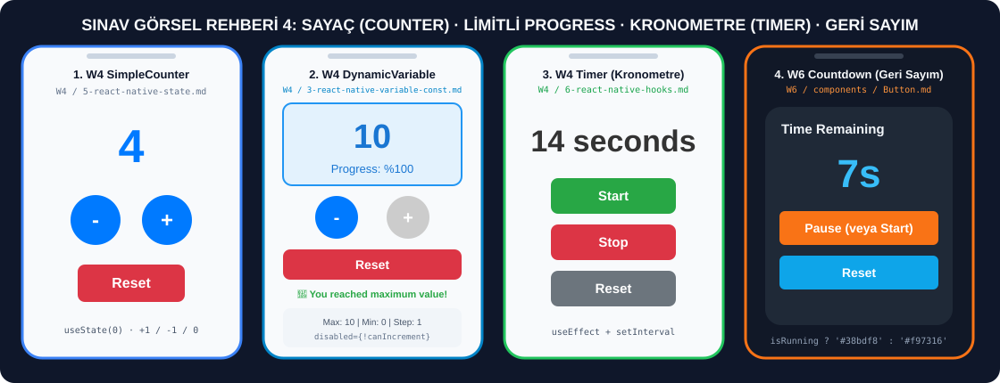

# 🔢 Sayaç (Counter), İlerleme Yüzdesi (Progress), Kronometre (Timer) ve Geri Sayım (Countdown) Senaryoları

> **[⬅️ Ana Sınav Rehberine (README) Dön](./README.md)**



---

## 📌 Bu Dosya Hangi Hafta ve Hangi Ders Kodlarına Karşılık Gelir?

| Hafta | Ders Notu Dosyası ve Konu Başlığı | Hocanın Kodundaki Bileşen Adı | Ne İşe Yarar? |
| :--- | :--- | :--- | :--- |
| **Hafta 4 (W4)** | `W4 / 5-react-native-state.md` — **Example 1: Simple Counter** | `SimpleCounter` | Ortada büyük mavi sayı (`count`), altında yan yana `-` ve `+` yuvarlak butonlar, en altta kırmızı `Reset` butonu gösterir. |
| **Hafta 4 (W4)** | `W4 / 3-react-native-variable-const.md` — **Example 2: Dynamic Variable Usage** | `DynamicVariableExample` | `0` ile `10` arasında sayar, `Progress: %...` hesaplar, `0`'da `-` butonunu, `10`'da `+` butonunu grileştirip kilitler (`disabled`) ve `10` olunca tebrik mesajı çıkarır. |
| **Hafta 4 (W4)** | `W4 / 6-react-native-hooks.md` — **useState Counter, WelcomeMessage & Timer** | `Counter`, `WelcomeMessage`, `Timer` | `useState` ile sayaç, `useEffect` + `setTimeout` ile 2 saniye sonra değişen karşılama mesajı ve `setInterval` ile ileri doğru sayan kronometre (`Start`, `Stop`, `Reset`) oluşturur. |
| **Hafta 4 (W4)** | `W4 / 2-example-hello-expo.md` — **Interactive Version** | `App` (Interactive) | Butona her basışta sayacı artırır, 5. tıklamada `Alert.alert` ile tebrik mesajı verir ve sayacı sıfırlar; uzun basınca (`onLongPress`) platform bilgisini gösterir. |
| **Hafta 6 (W6)** | `W6 / components / Button.md` — **Example 2: Countdown Start/Pause Buttons** | `CountdownController` | `10` saniyeden `0`'a doğru geri sayar; çalışırken sayı mavi (`#38bdf8`), duraklatıldığında turuncu (`#f97316`) olur; buton yazısı `Start` ve `Pause` arasında değişir. |

---

## ⚡ Sınavda Hoca Sayaç veya Timer Üzerinde Değişiklik İsterse Nereyi Değiştireceksin?

| Hocanın Görselde İstediği Değişiklik | Kodda Değiştireceğin Satır |
| :--- | :--- |
| Sayacın **Başlangıç Değerini** değiştirmek (ör. 10'dan başlasın) | `const [count, setCount] = useState(10);` |
| Sayacın **Artış / Azalış Miktarını** değiştirmek (ör. 5'er 5'er artsın) | `setCount(count + 5)` ve `setCount(count - 5)` (veya `const stepSize = 5;`) |
| Sayacın **Maksimum Sınırını** değiştirmek (ör. en fazla 20 olsun) | `const maxCount = 20;` |
| Sayı **Pozitifse Yeşil, Negatifse Kırmızı, 0 ise Gri** olsun | `color: count > 0 ? '#16a34a' : count < 0 ? '#dc2626' : '#64748b'` |
| Sayı **Çift ise Mavi, Tek ise Turuncu** olsun | `color: count % 2 === 0 ? '#2563eb' : '#ea580c'` |
| `+` ve `-` butonlarını **Yan Yana Değil Alt Alta** koymak | `buttonContainer` stilindeki `flexDirection: 'row'` satırını `'column'` yap |
| Geri sayım süresini **10 saniye yerine 30 saniye** yapmak | `const [timeLeft, setTimeLeft] = useState(30);` ve Reset içinde `setTimeLeft(30);` |

---

## 1️⃣ HAFTA 4 (W4) — Hocanın Orijinal Basit Sayaç Kodu (`SimpleCounter`)

* **Hafta ve Konu Başlığı:** Hafta 4 (W4) · `W4 / 5-react-native-state.md` · **Example 1: Simple Counter (`SimpleCounter`)**
* **Bu Kod Ne İşe Yarar?**
  * `useState(0)` ile başlangıç değeri `0` olan bir sayaç tutar.
  * Yan yana duran (`flexDirection: 'row'`) iki yuvarlak mavi butondan (`borderRadius: 50`) soldaki `-` sayıyı 1 azaltır, sağdaki `+` sayıyı 1 artırır.
  * Alttaki kırmızı (`#DC3545`) **Reset** butonu sayıyı tekrar `0` yapar.

```jsx
import React, { useState } from 'react';
import { View, Text, TouchableOpacity, StyleSheet } from 'react-native';

export default function SimpleCounter() {
  const [count, setCount] = useState(0);

  const increment = () => {
    setCount(count + 1);
  };

  const decrement = () => {
    setCount(count - 1);
  };

  const reset = () => {
    setCount(0);
  };

  return (
    <View style={styles.container}>
      <Text style={styles.title}>Simple Counter</Text>
      <Text style={styles.countText}>{count}</Text>
      
      <View style={styles.buttonContainer}>
        <TouchableOpacity style={styles.button} onPress={decrement}>
          <Text style={styles.buttonText}>-</Text>
        </TouchableOpacity>
        
        <TouchableOpacity style={styles.button} onPress={increment}>
          <Text style={styles.buttonText}>+</Text>
        </TouchableOpacity>
      </View>
      
      <TouchableOpacity style={styles.resetButton} onPress={reset}>
        <Text style={styles.buttonText}>Reset</Text>
      </TouchableOpacity>
    </View>
  );
}

const styles = StyleSheet.create({
  container: {
    flex: 1,
    justifyContent: 'center',
    alignItems: 'center',
    padding: 20,
  },
  title: {
    fontSize: 24,
    fontWeight: 'bold',
    marginBottom: 20,
    color: '#333',
  },
  countText: {
    fontSize: 48,
    fontWeight: 'bold',
    marginBottom: 30,
    color: '#007AFF',
  },
  buttonContainer: {
    flexDirection: 'row',
    marginBottom: 20,
  },
  button: {
    backgroundColor: '#007AFF',
    padding: 20,
    borderRadius: 50,
    margin: 10,
    minWidth: 60,
    alignItems: 'center',
  },
  resetButton: {
    backgroundColor: '#DC3545',
    padding: 15,
    borderRadius: 8,
    minWidth: 100,
    alignItems: 'center',
  },
  buttonText: {
    color: 'white',
    fontSize: 20,
    fontWeight: 'bold',
  },
});
```

---

## 2️⃣ HAFTA 4 (W4) — Hocanın Orijinal Limitli ve Yüzde İlerlemeli Sayaç Kodu (`DynamicVariableExample`)

* **Hafta ve Konu Başlığı:** Hafta 4 (W4) · `W4 / 3-react-native-variable-const.md` · **Example 2: Dynamic Variable Usage (`DynamicVariableExample`)**
* **Bu Kod Ne İşe Yarar?**
  * `maxCount = 10`, `minCount = 0` ve `stepSize = 1` sabitlerini kullanır.
  * `(currentCount / maxCount) * 100` formülüyle ilerleme yüzdesini (`Progress: %...`) hesaplar.
  * Sayı `0` iken `-` butonu, sayı `10` iken `+` butonu otomatik olarak grileşir (`styles.disabledButton`) ve devre dışı kalır (`disabled`).
  * Sayı `10` olduğunda (`isComplete`) ekranda yeşil renkle **`🎉 You reached maximum value!`** mesajı belirir.

```jsx
import React, { useState } from 'react';
import { View, Text, TouchableOpacity, StyleSheet } from 'react-native';

export default function DynamicVariableExample() {
  const [count, setCount] = useState(0);
  
  const maxCount = 10;
  const minCount = 0;
  const stepSize = 1;
  
  let currentCount = count;
  let canIncrement = currentCount < maxCount;
  let canDecrement = currentCount > minCount;
  
  const progress = (currentCount / maxCount) * 100;
  const isComplete = currentCount === maxCount;
  
  const increment = () => {
    if (canIncrement) {
      setCount(currentCount + stepSize);
    }
  };
  
  const decrement = () => {
    if (canDecrement) {
      setCount(currentCount - stepSize);
    }
  };
  
  const reset = () => {
    setCount(minCount);
  };
  
  return (
    <View style={styles.container}>
      <Text style={styles.title}>Dynamic Variable Example</Text>
      
      <View style={styles.counterBox}>
        <Text style={styles.countText}>{currentCount}</Text>
        <Text style={styles.progressText}>Progress: %{progress.toFixed(0)}</Text>
      </View>
      
      <View style={styles.buttonContainer}>
        <TouchableOpacity 
          style={[styles.button, !canDecrement && styles.disabledButton]} 
          onPress={decrement}
          disabled={!canDecrement}
        >
          <Text style={styles.buttonText}>-</Text>
        </TouchableOpacity>
        
        <TouchableOpacity 
          style={[styles.button, !canIncrement && styles.disabledButton]} 
          onPress={increment}
          disabled={!canIncrement}
        >
          <Text style={styles.buttonText}>+</Text>
        </TouchableOpacity>
      </View>
      
      <TouchableOpacity style={styles.resetButton} onPress={reset}>
        <Text style={styles.buttonText}>Reset</Text>
      </TouchableOpacity>
      
      {isComplete && (
        <Text style={styles.completeText}>🎉 You reached maximum value!</Text>
      )}
      
      <View style={styles.infoContainer}>
        <Text style={styles.infoText}>Maximum: {maxCount}</Text>
        <Text style={styles.infoText}>Minimum: {minCount}</Text>
        <Text style={styles.infoText}>Step: {stepSize}</Text>
      </View>
    </View>
  );
}

const styles = StyleSheet.create({
  container: {
    flex: 1,
    padding: 20,
    justifyContent: 'center',
  },
  title: {
    fontSize: 24,
    fontWeight: 'bold',
    textAlign: 'center',
    marginBottom: 30,
    color: '#333',
  },
  counterBox: {
    backgroundColor: '#e3f2fd',
    padding: 20,
    borderRadius: 10,
    alignItems: 'center',
    marginBottom: 30,
    borderWidth: 2,
    borderColor: '#2196f3',
  },
  countText: {
    fontSize: 48,
    fontWeight: 'bold',
    color: '#1976d2',
    marginBottom: 10,
  },
  progressText: {
    fontSize: 16,
    color: '#1976d2',
  },
  buttonContainer: {
    flexDirection: 'row',
    justifyContent: 'center',
    marginBottom: 20,
  },
  button: {
    backgroundColor: '#007AFF',
    padding: 20,
    borderRadius: 50,
    margin: 10,
    minWidth: 60,
    alignItems: 'center',
  },
  disabledButton: {
    backgroundColor: '#ccc',
  },
  resetButton: {
    backgroundColor: '#DC3545',
    padding: 15,
    borderRadius: 8,
    alignItems: 'center',
    marginBottom: 20,
  },
  buttonText: {
    color: 'white',
    fontSize: 20,
    fontWeight: 'bold',
  },
  completeText: {
    fontSize: 18,
    color: '#28A745',
    textAlign: 'center',
    marginBottom: 20,
    fontWeight: 'bold',
  },
  infoContainer: {
    backgroundColor: '#f8f9fa',
    padding: 15,
    borderRadius: 8,
    alignItems: 'center',
  },
  infoText: {
    fontSize: 14,
    color: '#666',
    marginBottom: 5,
  },
});
```

---

## 3️⃣ SINAV SENARYOSU 4A — Pozitif/Negatif/Sıfır Durumuna Göre Renk Değiştiren ve +1 / -1 / +5 / -5 Butonlu Sayaç

* **İlgili Ders Konusu:** Hafta 4 (`SimpleCounter` + `DynamicVariableExample`)
* **Bu Kod Ne İşe Yarar?**
  * Sayı **0'dan büyükse Yeşil (`#16a34a`)**, **0'dan küçükse Kırmızı (`#dc2626`)**, **0 ise Gri (`#475569`)** renkte görünür ve altında sayının durumunu (`Pozitif / Negatif / Sıfır` ve `Çift / Tek`) yazar.
  * Hem `+1 / -1` hem de `+5 / -5` butonları içerir.

```jsx
import React, { useState } from 'react';
import { SafeAreaView, View, Text, TouchableOpacity, StyleSheet } from 'react-native';

export default function ColorChangingMultiStepCounter() {
  const [count, setCount] = useState(0);

  const statusColor = count > 0 ? '#16a34a' : count < 0 ? '#dc2626' : '#475569';
  const statusBg = count > 0 ? '#dcfce7' : count < 0 ? '#fee2e2' : '#f1f5f9';
  const statusLabel = count > 0 ? 'Pozitif Sayı' : count < 0 ? 'Negatif Sayı' : 'Başlangıç (Sıfır)';
  const parityLabel = count % 2 === 0 ? 'Çift' : 'Tek';

  return (
    <SafeAreaView style={styles.safeArea}>
      <View style={styles.container}>
        <Text style={styles.title}>Duruma Göre Renk Değiştiren Sayaç</Text>

        <View style={[styles.displayBox, { backgroundColor: statusBg, borderColor: statusColor }]}>
          <Text style={[styles.numberText, { color: statusColor }]}>{count}</Text>
          <Text style={[styles.statusText, { color: statusColor }]}>
            {statusLabel} · ({parityLabel})
          </Text>
        </View>

        <View style={styles.row}>
          <TouchableOpacity style={[styles.btn, { backgroundColor: '#dc2626' }]} onPress={() => setCount(count - 5)}>
            <Text style={styles.btnText}>-5</Text>
          </TouchableOpacity>
          <TouchableOpacity style={[styles.btn, { backgroundColor: '#ea580c' }]} onPress={() => setCount(count - 1)}>
            <Text style={styles.btnText}>-1</Text>
          </TouchableOpacity>
          <TouchableOpacity style={[styles.btn, { backgroundColor: '#2563eb' }]} onPress={() => setCount(count + 1)}>
            <Text style={styles.btnText}>+1</Text>
          </TouchableOpacity>
          <TouchableOpacity style={[styles.btn, { backgroundColor: '#16a34a' }]} onPress={() => setCount(count + 5)}>
            <Text style={styles.btnText}>+5</Text>
          </TouchableOpacity>
        </View>

        <TouchableOpacity style={styles.resetBtn} onPress={() => setCount(0)}>
          <Text style={styles.btnText}>Sıfırla (Reset)</Text>
        </TouchableOpacity>
      </View>
    </SafeAreaView>
  );
}

const styles = StyleSheet.create({
  safeArea: { flex: 1, backgroundColor: '#f8fafc' },
  container: { flex: 1, justifyContent: 'center', padding: 24 },
  title: { fontSize: 22, fontWeight: 'bold', color: '#0f172a', textAlign: 'center', marginBottom: 24 },
  displayBox: {
    padding: 28,
    borderRadius: 18,
    borderWidth: 3,
    alignItems: 'center',
    marginBottom: 24,
  },
  numberText: { fontSize: 56, fontWeight: 'bold' },
  statusText: { fontSize: 16, fontWeight: '600', marginTop: 8 },
  row: { flexDirection: 'row', justifyContent: 'space-between', gap: 10, marginBottom: 16 },
  btn: { flex: 1, paddingVertical: 16, borderRadius: 12, alignItems: 'center' },
  resetBtn: { backgroundColor: '#0f172a', paddingVertical: 16, borderRadius: 12, alignItems: 'center' },
  btnText: { color: '#ffffff', fontSize: 18, fontWeight: 'bold' },
});
```

---

## 4️⃣ HAFTA 4 (W4) — Hocanın Orijinal Kronometre Kodu (`Timer` — Start / Stop / Reset)

* **Hafta ve Konu Başlığı:** Hafta 4 (W4) · `W4 / 6-react-native-hooks.md` · **useEffect Example 2: Timer (`Timer`)**
* **Bu Kod Ne İşe Yarar?**
  * `seconds` (saniye) ve `isRunning` (çalışıyor mu?) olmak üzere iki state tutar.
  * `Start` (yeşil `#28A745`) butonuna basılınca `isRunning` `true` olur ve `useEffect` içindeki `setInterval` her `1000` milisaniyede (1 saniyede) bir sayıyı 1 artırır.
  * `Stop` (kırmızı `#DC3545`) butonuna basılınca sayma durur; `Reset` (gri `#6C757D`) butonuna basılınca hem sayma durur hem de saniye `0` olur.

```jsx
import React, { useState, useEffect } from 'react';
import { View, Text, TouchableOpacity, StyleSheet } from 'react-native';

export default function Timer() {
  const [seconds, setSeconds] = useState(0);
  const [isRunning, setIsRunning] = useState(false);

  useEffect(() => {
    let interval;
    
    if (isRunning) {
      interval = setInterval(() => {
        setSeconds(seconds => seconds + 1);
      }, 1000);
    }

    return () => clearInterval(interval);
  }, [isRunning]);

  const startTimer = () => setIsRunning(true);
  const stopTimer = () => setIsRunning(false);
  const resetTimer = () => {
    setSeconds(0);
    setIsRunning(false);
  };

  return (
    <View style={styles.container}>
      <Text style={styles.timerText}>{seconds} seconds</Text>
      
      <TouchableOpacity 
        style={[styles.button, styles.startButton]} 
        onPress={startTimer}
      >
        <Text style={styles.buttonText}>Start</Text>
      </TouchableOpacity>
      
      <TouchableOpacity 
        style={[styles.button, styles.stopButton]} 
        onPress={stopTimer}
      >
        <Text style={styles.buttonText}>Stop</Text>
      </TouchableOpacity>
      
      <TouchableOpacity 
        style={[styles.button, styles.resetButton]} 
        onPress={resetTimer}
      >
        <Text style={styles.buttonText}>Reset</Text>
      </TouchableOpacity>
    </View>
  );
}

const styles = StyleSheet.create({
  container: {
    flex: 1,
    justifyContent: 'center',
    alignItems: 'center',
    padding: 20,
  },
  timerText: {
    fontSize: 48,
    fontWeight: 'bold',
    marginBottom: 40,
    color: '#333',
  },
  button: {
    padding: 15,
    borderRadius: 8,
    margin: 10,
    minWidth: 120,
    alignItems: 'center',
  },
  startButton: {
    backgroundColor: '#28A745',
  },
  stopButton: {
    backgroundColor: '#DC3545',
  },
  resetButton: {
    backgroundColor: '#6C757D',
  },
  buttonText: {
    color: 'white',
    fontSize: 16,
    fontWeight: '600',
  },
});
```

---

## 5️⃣ HAFTA 6 (W6) — Hocanın Orijinal Geri Sayım Kodu (`CountdownController`)

* **Hafta ve Konu Başlığı:** Hafta 6 (W6) · `W6 / components / Button.md` · **Example 2: Countdown Start/Pause Buttons (`CountdownController`)**
* **Bu Kod Ne İşe Yarar?**
  * `10` saniyeden geriye doğru (`10s`, `9s`, ..., `0s`) sayar; `0`'a ulaştığında otomatik olarak durur.
  * Geri sayım çalışırken (`isRunning === true`) sayı rengi açık mavi (`#38bdf8`), buton yazısı `'Pause'` ve buton rengi turuncu (`#f97316`) olur.
  * Duraklatıldığında sayı rengi turuncu (`#f97316`), buton yazısı `'Start'` ve buton rengi mavi (`#2563eb`) olur.

```jsx
import React, { useEffect, useState } from 'react';
import { Button, SafeAreaView, Text, View } from 'react-native';

export default function CountdownController() {
  const [timeLeft, setTimeLeft] = useState(10);
  const [isRunning, setRunning] = useState(false);

  useEffect(() => {
    if (!isRunning) return;

    const timer = setInterval(() => {
      setTimeLeft((prev) => {
        if (prev <= 1) {
          setRunning(false);
          return 0;
        }
        return prev - 1;
      });
    }, 1000);

    return () => clearInterval(timer);
  }, [isRunning]);

  return (
    <SafeAreaView style={{ flex: 1, backgroundColor: '#111827' }}>
      <View
        style={{
          flex: 1,
          justifyContent: 'center',
          padding: 24,
          gap: 16,
        }}
      >
        <View
          style={{
            borderRadius: 20,
            backgroundColor: '#1f2937',
            padding: 24,
            gap: 16,
          }}
        >
          <Text style={{ fontSize: 18, fontWeight: '600', color: '#f1f5f9' }}>
            Time Remaining
          </Text>
          <Text
            style={{
              fontSize: 48,
              fontWeight: '700',
              color: isRunning ? '#38bdf8' : '#f97316',
              textAlign: 'center',
            }}
          >
            {timeLeft}s
          </Text>
          <Button
            title={isRunning ? 'Pause' : 'Start'}
            onPress={() => setRunning((prev) => !prev)}
            color={isRunning ? '#f97316' : '#2563eb'}
          />
          <Button
            title="Reset"
            onPress={() => {
              setTimeLeft(10);
              setRunning(false);
            }}
            color="#0ea5e9"
            disabled={timeLeft === 10 && !isRunning}
          />
        </View>
      </View>
    </SafeAreaView>
  );
}
```

---

## 6️⃣ HAFTA 4 (W4) — Hocanın 5 Tıklamada Alert Veren ve Uzun Basmayı Algılayan Kodu (`Hello Expo Interactive`)

* **Hafta ve Konu Başlığı:** Hafta 4 (W4) · `W4 / 2-example-hello-expo.md` · **Interactive Version**
* **Bu Kod Ne İşe Yarar?**
  * Butona kısa basıldıkça (`onPress`) sayacı artırır ve `count >= 5` olduğunda `Alert.alert('Congratulations!', 'You clicked 5 times! 🎉')` mesajı çıkarıp sayacı sıfırlar.
  * Butona uzun basıldığında (`onLongPress`) cihazın işletim sistemini (`Platform.OS`) ve versiyonunu (`Platform.Version`) gösteren bir uyarı penceresi açar.

```jsx
import React, { useState } from 'react';
import { 
  StatusBar, 
  StyleSheet, 
  Text, 
  View, 
  SafeAreaView, 
  Platform,
  TouchableOpacity,
  Alert
} from 'react-native';

export default function InteractiveHelloExpo() {
  const [count, setCount] = useState(0);
  const [message] = useState('Welcome to React Native!');

  const handlePress = () => {
    setCount(count + 1);
    if (count >= 5) {
      Alert.alert('Congratulations!', 'You clicked 5 times! 🎉');
      setCount(0);
    }
  };

  const handleLongPress = () => {
    Alert.alert(
      'Platform Information',
      `Platform: ${Platform.OS}\nVersion: ${Platform.Version}`,
      [{ text: 'OK' }]
    );
  };

  return (
    <SafeAreaView style={styles.container}>
      <View style={styles.content}>
        <Text style={styles.title}>{message}</Text>
        
        <TouchableOpacity 
          style={styles.button}
          onPress={handlePress}
          onLongPress={handleLongPress}
        >
          <Text style={styles.buttonText}>
            Click Count: {count}
          </Text>
        </TouchableOpacity>

        <Text style={styles.hint}>
          Long press: Platform info{'\n'}
          Short press: Increment counter
        </Text>
      </View>
      <StatusBar style="auto" />
    </SafeAreaView>
  );
}

const styles = StyleSheet.create({
  container: {
    flex: 1,
    backgroundColor: '#f7fafc',
  },
  content: {
    flex: 1,
    alignItems: 'center',
    justifyContent: 'center',
    paddingHorizontal: 20,
  },
  title: {
    fontSize: 24,
    fontWeight: 'bold',
    color: '#2d3748',
    marginBottom: 40,
    textAlign: 'center',
  },
  button: {
    backgroundColor: '#4299e1',
    paddingHorizontal: 32,
    paddingVertical: 16,
    borderRadius: 12,
    marginBottom: 20,
    shadowColor: '#000',
    shadowOffset: {
      width: 0,
      height: 2,
    },
    shadowOpacity: 0.1,
    shadowRadius: 4,
    elevation: 3,
  },
  buttonText: {
    color: 'white',
    fontSize: 18,
    fontWeight: '600',
  },
  hint: {
    fontSize: 14,
    color: '#718096',
    textAlign: 'center',
    lineHeight: 20,
  },
});
```
