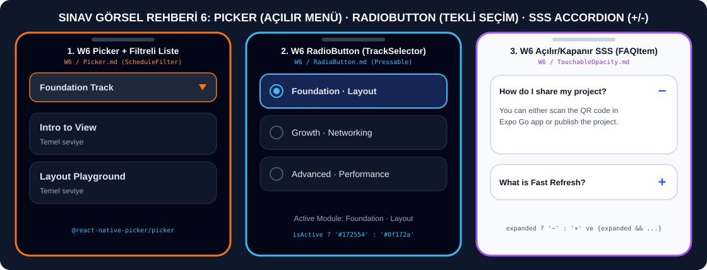

# 🔘 Picker (Açılır Menü), RadioButton (Tekli Seçim) ve Açılır/Kapanır Kart (Accordion) Senaryoları

> **[⬅️ Ana Sınav Rehberine (README) Dön](./README.md)**



---

## 📌 Bu Dosya Hangi Hafta ve Hangi Ders Kodlarına Karşılık Gelir?

| Hafta | Ders Notu Dosyası ve Konu Başlığı | Hocanın Kodundaki Bileşen Adı | Ne İşe Yarar? |
| :--- | :--- | :--- | :--- |
| **Hafta 6 (W6)** | `W6 / components / Picker.md` — **Example 1: Course Level Selector** | `CourseLevelPicker` | `@react-native-picker/picker` açılır menüsünden seçilen ders seviyesinin başlığını üstte büyük yazıyla gösterir. |
| **Hafta 6 (W6)** | `W6 / components / Picker.md` — **Example 2: Session Filter + Dependent List** | `ScheduleFilter` | Açılır menüden seçilen seviyeye (`foundation`, `growth`, `advanced`) göre alttaki `FlatList` oturumlarını filtreler. |
| **Hafta 6 (W6)** | `W6 / components / RadioButton.md` — **Example 1: Module Selection** | `ModuleSelector` & `RadioItem` | `Pressable` ve iç içe iki yuvarlak `View` ile özel RadioButton oluşturur; seçilen modülü üstte yazar. |
| **Hafta 6 (W6)** | `W6 / components / RadioButton.md` — **Example 2: FlatList-powered Track Picker** | `TrackSelector` | `FlatList` içinde kart görünümlü RadioButton'lar oluşturur; seçili kartın arka planı `#172554`, çerçevesi `#38bdf8` olur. |
| **Hafta 6 (W6)** | `W6 / components / TouchableOpacity.md` — **Example 2: FAQ Card with Expandable Content** | `FAQItem` | Tıklandığında sağdaki `+` işaretini `−` yapan ve altındaki cevap metnini açıp kapatan (`expanded`) SSS kartı oluşturur. |

---

## ⚡ Sınavda Hoca Picker, RadioButton veya Açılır Kart İsterse Nereyi Değiştireceksin?

| Hocanın Görselde İstediği Değişiklik | Kodda Değiştireceğin Satır |
| :--- | :--- |
| **Picker'a Yeni Seçenek** eklemek | `<Picker.Item label="Yeni Seçenek" value="yeni" />` ekle veya dizinin içine yeni obje ekle |
| **RadioButton'u Yuvarlak Yerine Kare** yapmak | Dış `View` stilinde `borderRadius: 11` yerine `borderRadius: 4` yaz |
| **RadioButton Seçili Rengini** değiştirmek | `borderColor: isSelected ? '#ec4899' : '#475569'` ve iç nokta `backgroundColor: '#ec4899'` |
| **RadioButton'ları Alt Alta Değil Yan Yana** dizmek | RadioButton'ları saran `View` stiline `flexDirection: 'row', justifyContent: 'space-around'` ekle |
| **FAQ Kartının Başlangıçta Açık Gelmesini** sağlamak | `const [expanded, setExpanded] = useState(true);` |

---

## 1️⃣ HAFTA 6 (W6) — Hocanın Orijinal Picker (Açılır Menü) Kodu (`CourseLevelPicker`)

* **Hafta ve Konu Başlığı:** Hafta 6 (W6) · `W6 / components / Picker.md` · **Example 1: Course Level Selector (`CourseLevelPicker`)**
* **Bu Kod Ne İşe Yarar?**
  * `@react-native-picker/picker` paketini kullanır (Snack Expo'da sağ altta çıkan **Add dependency** butonuna basarak paketi ekleyebilirsin).
  * Kullanıcı açılır menüden bir seviye seçtiğinde `onValueChange={(value) => setLevel(value)}` çalışır ve üstteki büyük başlık (`COURSE_LEVELS.find(...)?.label`) anında güncellenir.

```jsx
import React, { useState } from 'react';
import { SafeAreaView, View, Text } from 'react-native';
import { Picker } from '@react-native-picker/picker';

const COURSE_LEVELS = [
  { id: 'foundation', label: 'Foundation · Components' },
  { id: 'growth', label: 'Growth · Navigation' },
  { id: 'advanced', label: 'Advanced · Performance' },
];

export default function CourseLevelPicker() {
  const [level, setLevel] = useState('foundation');

  return (
    <SafeAreaView style={{ flex: 1, backgroundColor: '#0f172a', padding: 24 }}>
      <Text style={{ color: '#94a3b8', fontSize: 16 }}>Aktif Ders Bloğu</Text>
      <Text style={{ color: '#e2e8f0', fontSize: 28, fontWeight: '700' }}>
        {COURSE_LEVELS.find((item) => item.id === level)?.label}
      </Text>

      <View style={{ marginTop: 32, backgroundColor: '#1e293b', borderRadius: 12 }}>
        <Picker
          selectedValue={level}
          onValueChange={(value) => setLevel(value)}
          style={{ color: '#e2e8f0' }}
          dropdownIconColor="#38bdf8"
        >
          {COURSE_LEVELS.map((item) => (
            <Picker.Item
              key={item.id}
              label={item.label}
              value={item.id}
              color="#e2e8f0"
            />
          ))}
        </Picker>
      </View>
    </SafeAreaView>
  );
}
```

---

## 2️⃣ HAFTA 6 (W6) — Hocanın Orijinal Picker ile Liste Filtreleme Kodu (`ScheduleFilter`)

* **Hafta ve Konu Başlığı:** Hafta 6 (W6) · `W6 / components / Picker.md` · **Example 2: Session Filter + Dependent List (`ScheduleFilter`)**
* **Bu Kod Ne İşe Yarar?**
  * Üstteki `Picker` içinden seçilen `track` değerine (`foundation`, `growth`, `advanced`) göre `SESSIONS` dizisini filtreler (`SESSIONS.filter((session) => session.track === track)`).
  * Seçilen seviyeye ait dersleri alttaki `FlatList` içinde gösterir ve her kartın altında Türkçe olarak `Temel seviye`, `Orta seviye` veya `İleri seviye` yazar.

```jsx
import React, { useMemo, useState } from 'react';
import { SafeAreaView, View, Text, FlatList } from 'react-native';
import { Picker } from '@react-native-picker/picker';

const SESSIONS = [
  { id: '1', title: 'Intro to View', track: 'foundation' },
  { id: '2', title: 'Layout Playground', track: 'foundation' },
  { id: '3', title: 'State Drill', track: 'growth' },
  { id: '4', title: 'FlatList Patterns', track: 'growth' },
  { id: '5', title: 'Perf Budgeting', track: 'advanced' },
];

export default function ScheduleFilter() {
  const [track, setTrack] = useState('foundation');
  const filtered = useMemo(
    () => SESSIONS.filter((session) => session.track === track),
    [track]
  );

  return (
    <SafeAreaView style={{ flex: 1, backgroundColor: '#020617', padding: 24 }}>
      <View
        style={{
          backgroundColor: '#1e293b',
          borderRadius: 14,
          paddingHorizontal: 12,
        }}
      >
        <Picker
          selectedValue={track}
          onValueChange={(value) => setTrack(value)}
          mode="dropdown"
          dropdownIconColor="#f97316"
        >
          <Picker.Item label="Foundation Track" value="foundation" />
          <Picker.Item label="Growth Track" value="growth" />
          <Picker.Item label="Advanced Track" value="advanced" />
        </Picker>
      </View>

      <FlatList
        data={filtered}
        keyExtractor={(item) => item.id}
        contentContainerStyle={{ gap: 12, marginTop: 24 }}
        renderItem={({ item }) => (
          <View
            style={{
              backgroundColor: '#0f172a',
              padding: 18,
              borderRadius: 16,
              borderWidth: 1,
              borderColor: '#1f2937',
            }}
          >
            <Text style={{ color: '#e2e8f0', fontSize: 16, fontWeight: '600' }}>
              {item.title}
            </Text>
            <Text style={{ color: '#94a3b8', marginTop: 4 }}>
              {track === 'foundation' ? 'Temel' : track === 'growth' ? 'Orta' : 'İleri'} seviye
            </Text>
          </View>
        )}
        ListEmptyComponent={
          <Text style={{ color: '#94a3b8', textAlign: 'center', marginTop: 32 }}>
            Bu track için oturum planlanmadı.
          </Text>
        }
      />
    </SafeAreaView>
  );
}
```

---

## 3️⃣ HAFTA 6 (W6) — Hocanın Orijinal RadioButton Kodları (`ModuleSelector` ve `TrackSelector`)

### A) `ModuleSelector` (`W6 / components / RadioButton.md` — Example 1)
* **Bu Kod Ne İşe Yarar?**
  * Harici paket gerektirmeden `Pressable` ve iç içe iki yuvarlak `View` (`width: 22, borderRadius: 11` dış çember + `width: 10, borderRadius: 5` iç mavi nokta) ile RadioButton oluşturur.

```jsx
import React, { useState } from 'react';
import { SafeAreaView, View, Text, Pressable } from 'react-native';

const MODULES = [
  { id: 'core', title: 'Core Components' },
  { id: 'state', title: 'State & Props' },
  { id: 'nav', title: 'Navigation' },
];

function RadioItem({ label, value, isSelected, onPress }) {
  return (
    <Pressable
      accessibilityRole="radio"
      accessibilityState={{ selected: isSelected }}
      onPress={() => onPress(value)}
      style={{ flexDirection: 'row', alignItems: 'center', gap: 12, paddingVertical: 10 }}
    >
      <View
        style={{
          width: 22,
          height: 22,
          borderRadius: 11,
          borderWidth: 2,
          borderColor: isSelected ? '#38bdf8' : '#475569',
          alignItems: 'center',
          justifyContent: 'center',
        }}
      >
        {isSelected && (
          <View
            style={{
              width: 10,
              height: 10,
              borderRadius: 5,
              backgroundColor: '#38bdf8',
            }}
          />
        )}
      </View>
      <Text style={{ color: '#e2e8f0', fontSize: 16 }}>{label}</Text>
    </Pressable>
  );
}

export default function ModuleSelector() {
  const [value, setValue] = useState('core');

  return (
    <SafeAreaView style={{ flex: 1, backgroundColor: '#0f172a', padding: 24 }}>
      <Text style={{ color: '#94a3b8' }}>Active Module</Text>
      <Text style={{ color: '#e2e8f0', fontSize: 22, fontWeight: '700', marginBottom: 16 }}>
        {MODULES.find((item) => item.id === value)?.title}
      </Text>
      {MODULES.map((item) => (
        <RadioItem
          key={item.id}
          label={item.title}
          value={item.id}
          isSelected={value === item.id}
          onPress={setValue}
        />
      ))}
    </SafeAreaView>
  );
}
```

### B) `TrackSelector` (`W6 / components / RadioButton.md` — Example 2)
* **Bu Kod Ne İşe Yarar?**
  * `FlatList` içinde kart şeklinde RadioButton'lar gösterir.
  * Tıklanan kart aktif (`isActive`) olduğunda arka planı `#172554`, kenarlığı `#38bdf8` olur ve içindeki mavi nokta görünür.

```jsx
import React, { useState } from 'react';
import { SafeAreaView, FlatList, View, Text, Pressable } from 'react-native';

const TRACKS = [
  { id: 'foundation', label: 'Foundation · Layout' },
  { id: 'growth', label: 'Growth · Networking' },
  { id: 'advanced', label: 'Advanced · Performance' },
  { id: 'capstone', label: 'Capstone · Final Project' },
];

export default function TrackSelector() {
  const [selected, setSelected] = useState('foundation');

  return (
    <SafeAreaView style={{ flex: 1, backgroundColor: '#020617', paddingTop: 24 }}>
      <FlatList
        data={TRACKS}
        keyExtractor={(item) => item.id}
        contentContainerStyle={{ paddingHorizontal: 24, gap: 12 }}
        renderItem={({ item }) => {
          const isActive = item.id === selected;
          return (
            <Pressable
              accessibilityRole="radio"
              accessibilityState={{ selected: isActive }}
              onPress={() => setSelected(item.id)}
              style={{
                backgroundColor: isActive ? '#172554' : '#0f172a',
                borderRadius: 16,
                padding: 16,
                borderWidth: 1,
                borderColor: isActive ? '#38bdf8' : '#1e293b',
                flexDirection: 'row',
                alignItems: 'center',
                gap: 12,
              }}
            >
              <View
                style={{
                  width: 20,
                  height: 20,
                  borderRadius: 10,
                  borderWidth: 2,
                  borderColor: isActive ? '#38bdf8' : '#475569',
                  alignItems: 'center',
                  justifyContent: 'center',
                }}
              >
                {isActive && (
                  <View
                    style={{
                      width: 10,
                      height: 10,
                      borderRadius: 5,
                      backgroundColor: '#38bdf8',
                    }}
                  />
                )}
              </View>
              <Text style={{ color: '#e2e8f0', fontSize: 16 }}>{item.label}</Text>
            </Pressable>
          );
        }}
      />
    </SafeAreaView>
  );
}
```

---

## 4️⃣ HAFTA 6 (W6) — Hocanın Orijinal Açılır/Kapanır SSS Kartı Kodu (`FAQItem`)

* **Hafta ve Konu Başlığı:** Hafta 6 (W6) · `W6 / components / TouchableOpacity.md` · **Example 2: FAQ Card with Expandable Content (`FAQItem`)**
* **Bu Kod Ne İşe Yarar?**
  * Başlık satırına tıklandığında `setExpanded((prev) => !prev)` ile `expanded` durumunu tersine çevirir.
  * Sağdaki simge açıksa `'−'`, kapalıysa `'+'` gösterir; `{expanded && (...)}` koşuluyla cevabı sadece açıkken gösterir.

```jsx
import React, { useState } from 'react';
import { SafeAreaView, Text, TouchableOpacity, View } from 'react-native';

const QUESTION = 'How do I share my project with Expo?';
const ANSWER =
  'You can either scan the QR code in the Expo Go app or publish the project with the expo publish command.';

export default function FAQItem() {
  const [expanded, setExpanded] = useState(false);

  return (
    <SafeAreaView style={{ flex: 1, backgroundColor: '#f8fafc' }}>
      <View
        style={{
          flex: 1,
          justifyContent: 'center',
          padding: 24,
        }}
      >
        <View
          style={{
            borderRadius: 16,
            backgroundColor: '#fff',
            shadowColor: '#000',
            shadowOpacity: 0.04,
            shadowRadius: 12,
            elevation: 2,
          }}
        >
          <TouchableOpacity
            onPress={() => setExpanded((prev) => !prev)}
            activeOpacity={0.6}
            style={{
              padding: 20,
              flexDirection: 'row',
              justifyContent: 'space-between',
              alignItems: 'center',
            }}
          >
            <Text style={{ fontWeight: '600', flex: 1, fontSize: 16 }}>
              {QUESTION}
            </Text>
            <Text style={{ color: '#2563eb', marginLeft: 16, fontSize: 18 }}>
              {expanded ? '−' : '+'}
            </Text>
          </TouchableOpacity>
          {expanded && (
            <View style={{ paddingHorizontal: 20, paddingBottom: 20 }}>
              <Text style={{ color: '#475569', lineHeight: 20 }}>{ANSWER}</Text>
            </View>
          )}
        </View>
      </View>
    </SafeAreaView>
  );
}
```

---

## 5️⃣ SINAV SENARYOSU 6A — RadioButton ile Renk / Cinsiyet / Tema Seçildiğinde Kartın ve Butonun Rengini Değiştirme

* **İlgili Ders Konusu:** Hafta 6 (`RadioButton.md`) + Hafta 3 (`12-styling-example.jsx` — `ThemeSystem`)
* **Bu Kod Ne İşe Yarar?**
  * Harici kütüphane gerektirmeden çalışan RadioButton'lar ile **Pembe (Kadın Teması), Mavi (Erkek Teması), Yeşil (Doğa Teması), Koyu (Gece Teması)** seçimi yaptırır ve tüm ekranın/kartın rengini anında seçilen temaya göre değiştirir!

```jsx
import React, { useState } from 'react';
import { SafeAreaView, View, Text, Pressable, StyleSheet } from 'react-native';

const THEMES = [
  { id: 'female', label: 'Kadın / Pembe Tema', bg: '#fdf2f8', card: '#fce7f3', accent: '#db2777', text: '#831843' },
  { id: 'male', label: 'Erkek / Mavi Tema', bg: '#eff6ff', card: '#dbeafe', accent: '#2563eb', text: '#1e3a8a' },
  { id: 'nature', label: 'Doğa / Yeşil Tema', bg: '#f0fdf4', card: '#dcfce7', accent: '#16a34a', text: '#14532d' },
  { id: 'dark', label: 'Gece / Koyu Tema', bg: '#0f172a', card: '#1e293b', accent: '#38bdf8', text: '#f8fafc' },
];

export default function RadioThemeColorSwitcher() {
  const [selectedId, setSelectedId] = useState('female');
  const activeTheme = THEMES.find((t) => t.id === selectedId) || THEMES[0];

  return (
    <SafeAreaView style={[styles.safeArea, { backgroundColor: activeTheme.bg }]}>
      <View style={styles.container}>
        <View style={[styles.previewBox, { backgroundColor: activeTheme.card, borderColor: activeTheme.accent }]}>
          <Text style={[styles.previewTitle, { color: activeTheme.text }]}>
            Aktif Seçim: {activeTheme.label}
          </Text>
          <Text style={[styles.previewSub, { color: activeTheme.accent }]}>
            Aşağıdaki RadioButton seçeneklerinden birine dokunarak rengi değiştirin.
          </Text>
        </View>

        <View style={styles.radioList}>
          {THEMES.map((item) => {
            const isSelected = item.id === selectedId;
            return (
              <Pressable
                key={item.id}
                onPress={() => setSelectedId(item.id)}
                style={[
                  styles.radioCard,
                  {
                    backgroundColor: isSelected ? item.card : '#ffffff',
                    borderColor: isSelected ? item.accent : '#cbd5e1',
                  },
                ]}
              >
                <View style={[styles.outerCircle, { borderColor: isSelected ? item.accent : '#64748b' }]}>
                  {isSelected && <View style={[styles.innerDot, { backgroundColor: item.accent }]} />}
                </View>
                <Text style={[styles.radioLabel, { color: isSelected ? item.accent : '#334155' }]}>
                  {item.label}
                </Text>
              </Pressable>
            );
          })}
        </View>
      </View>
    </SafeAreaView>
  );
}

const styles = StyleSheet.create({
  safeArea: { flex: 1 },
  container: { flex: 1, justifyContent: 'center', padding: 24, gap: 20 },
  previewBox: { padding: 24, borderRadius: 18, borderWidth: 2, alignItems: 'center', gap: 8 },
  previewTitle: { fontSize: 20, fontWeight: 'bold', textAlign: 'center' },
  previewSub: { fontSize: 14, textAlign: 'center', fontWeight: '600' },
  radioList: { gap: 12 },
  radioCard: {
    flexDirection: 'row',
    alignItems: 'center',
    padding: 16,
    borderRadius: 14,
    borderWidth: 2,
    gap: 12,
  },
  outerCircle: {
    width: 24,
    height: 24,
    borderRadius: 12,
    borderWidth: 2,
    alignItems: 'center',
    justifyContent: 'center',
  },
  innerDot: { width: 12, height: 12, borderRadius: 6 },
  radioLabel: { fontSize: 16, fontWeight: 'bold' },
});
```
