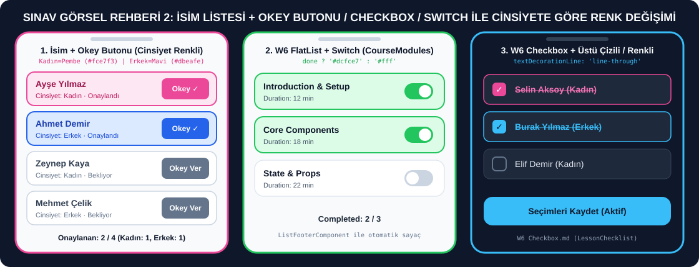
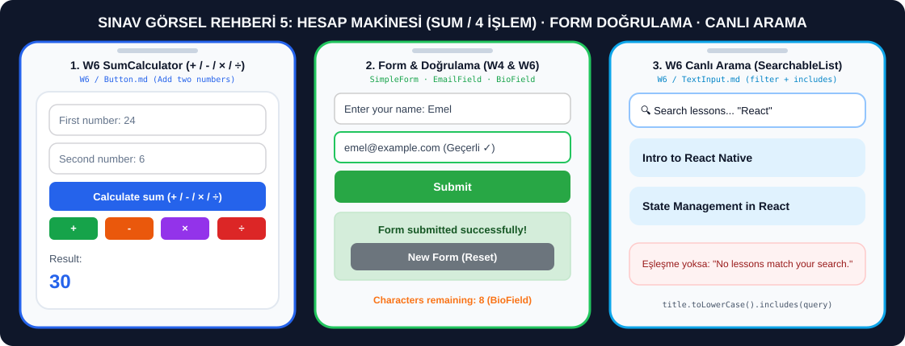
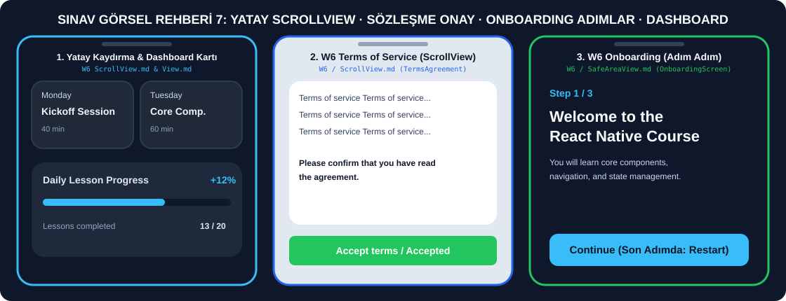

# 📱 Mobil Uygulama Geliştirme — Snack Expo Sınav Rehberi (W2 – W6)

Bu depo, **Hafta 2 (W2), Hafta 3 (W3), Hafta 4 (W4) ve Hafta 6 (W6)** *(W7 dahil değil)* konularını kapsayan **Snack Expo (`snack.expo.dev`)** açık kitap sınavı için hazırlanmış görsel senaryo ve kod rehberidir.

Sınavda hocanın verdiği görsele baktığında **hangi kod bloğunu kullanacağını** ve **hangi satırı değiştirerek o görseli elde edeceğini** aşağıdaki görsel rehberlerden ve tablolardan saniyeler içinde bulabilirsin.

---

## 🚀 1. ADIM: Hocanın Verdiği Görsel Hangisine Benziyor? (Dosyaya Tıkla, Kodu Kopyala)

| # | Sınavda Karşına Çıkabilecek Görsel Senaryo | İlgili Haftalar & Hoca Örnekleri | Rehber Dosyası |
| :-: | :--- | :--- | :--- |
| **01** | 📸 **Yan Yana, Alt Alta, 2x2 Grid veya Yuvarlak Fotoğraflar** (`Image`, `resizeMode`, `blurRadius`, Fotoğraf Değiştirme) | **W4** (`ImageExamples`, `BasicView`) · **W6** (`NewsCard`, `ImagePlayground`, `ResponsiveGrid`) | **[👉 01-Fotograf-Dizilimleri-ve-Image-Senaryolari.md](./01-Fotograf-Dizilimleri-ve-Image-Senaryolari.md)** |
| **02** | 👥 **İsimlerin Yanında Okey Butonu / Checkbox / Switch (Tıkladıkça Cinsiyete veya Nota Göre Renk Değiştiren Liste)** | **W6** (`CourseModules`, `LessonChecklist`, `ParticipantSettings`) · **W3** (`ConditionalList`) | **[👉 02-Isim-Listesi-Cinsiyet-Renk-ve-Buton-Senaryolari.md](./02-Isim-Listesi-Cinsiyet-Renk-ve-Buton-Senaryolari.md)** |
| **03** | 🎨 **Buton Rengi, Buton Yeri, Yazı Tipi/Boyutu/Rengi Değiştirme, Yeni Yazı veya Buton Ekleme** | **W4** (`ButtonExample`, `MessageExample`, `VariableExample`, `TextExamples`) · **W6** (`RichTextBanner`, `CourseCard`) | **[👉 03-Buton-Yazi-Renk-Konum-Degistirme-Rehberi.md](./03-Buton-Yazi-Renk-Konum-Degistirme-Rehberi.md)** |
| **04** | 🔢 **Sayaç (`+` / `-` / `Reset`), Yüzde İlerleme (`% Progress`), Kronometre (`Timer`) ve Geri Sayım (`10s Countdown`)** | **W4** (`SimpleCounter`, `DynamicVariableExample`, `Timer`, `InteractiveHelloExpo`) · **W6** (`CountdownController`) | **[👉 04-Sayac-Timer-ve-Sayisal-Senaryolar.md](./04-Sayac-Timer-ve-Sayisal-Senaryolar.md)** |
| **05** | 🧮 **Hesap Makinesi (Toplama & 4 İşlem), Form Gönderimi, Karakter Sayacı ve Canlı Arama Çubuğu** | **W6** (`SumCalculator`, `BioField`, `EmailField`, `SearchableList`) · **W4** (`SimpleForm`, `TextInputExample`) | **[👉 05-Hesap-Makinesi-Form-Input-ve-Arama-Senaryolari.md](./05-Hesap-Makinesi-Form-Input-ve-Arama-Senaryolari.md)** |
| **06** | 🔘 **Picker (Açılır Menü), RadioButton (Tekli Daire Seçim) ve Açılır/Kapanır SSS Kartı (`+ / −`)** | **W6** (`CourseLevelPicker`, `ScheduleFilter`, `ModuleSelector`, `TrackSelector`, `FAQItem`) | **[👉 06-Picker-RadioButton-Checkbox-ve-Secim-Senaryolari.md](./06-Picker-RadioButton-Checkbox-ve-Secim-Senaryolari.md)** |
| **07** | 📜 **Yatay/Dikey ScrollView, En Alta İnince Aktifleşen Buton, Adım Adım Onboarding (`Step 1/3`) ve Dashboard Kartı** | **W6** (`WeeklySchedule`, `TermsAgreement`, `OnboardingScreen`, `NotchedHeaderDemo`, `DashboardCard`, `InfiniteNotes`) | **[👉 07-ScrollView-FlatList-SafeArea-ve-Kart-Senaryolari.md](./07-ScrollView-FlatList-SafeArea-ve-Kart-Senaryolari.md)** |
| **08** | ⚛️ **W2, W3 ve W4 Temel Kodları: Hava Durumu Önerisi, Vergi Hesabı, Todo List, Login/Logout, Rol ve Stok Filtresi** | **W2** (`06_control_flow`, `08_functions`) · **W3** (`07-conditional`, `08-list`, `10-data-sharing`) · **W4** (`HelloExpo`, `Props`, `WelcomeMessage`) | **[👉 08-W2-W3-W4-Temel-Kodlar-Props-State-Hooks.md](./08-W2-W3-W4-Temel-Kodlar-Props-State-Hooks.md)** |

---

## 🖼️ 2. ADIM: Görsel Ekran Önizlemeleri (Görsele Bakarak Senaryoyu Tanı)

### 📸 Görsel Rehber 1: Fotoğraf Dizilimleri (`01-Fotograf-Dizilimleri-ve-Image-Senaryolari.md`)
👉 **[Kodlara Gitmek İçin Tıkla](./01-Fotograf-Dizilimleri-ve-Image-Senaryolari.md)**

---

### 👥 Görsel Rehber 2: İsim Listesi + Okey Butonu / Checkbox / Switch ile Cinsiyete Göre Renk Değişimi (`02-Isim-Listesi-Cinsiyet-Renk-ve-Buton-Senaryolari.md`)
👉 **[Kodlara Gitmek İçin Tıkla](./02-Isim-Listesi-Cinsiyet-Renk-ve-Buton-Senaryolari.md)**

---

### 🎨 Görsel Rehber 3: Buton Yeri, Buton Rengi/Şekli ve Yazı Tipi Değişimleri (`03-Buton-Yazi-Renk-Konum-Degistirme-Rehberi.md`)
👉 **[Kodlara Gitmek İçin Tıkla](./03-Buton-Yazi-Renk-Konum-Degistirme-Rehberi.md)**

---

### 🔢 Görsel Rehber 4: Sayaç, Limitli Yüzde, Kronometre ve Geri Sayım (`04-Sayac-Timer-ve-Sayisal-Senaryolar.md`)
👉 **[Kodlara Gitmek İçin Tıkla](./04-Sayac-Timer-ve-Sayisal-Senaryolar.md)**

---

### 🧮 Görsel Rehber 5: Hesap Makinesi, Form Doğrulama ve Canlı Arama (`05-Hesap-Makinesi-Form-Input-ve-Arama-Senaryolari.md`)
👉 **[Kodlara Gitmek İçin Tıkla](./05-Hesap-Makinesi-Form-Input-ve-Arama-Senaryolari.md)**

---

### 🔘 Görsel Rehber 6: Picker, RadioButton ve Açılır/Kapanır SSS Kartı (`06-Picker-RadioButton-Checkbox-ve-Secim-Senaryolari.md`)
👉 **[Kodlara Gitmek İçin Tıkla](./06-Picker-RadioButton-Checkbox-ve-Secim-Senaryolari.md)**

---

### 📜 Görsel Rehber 7: Yatay ScrollView, Sözleşme Onay, Onboarding ve Dashboard (`07-ScrollView-FlatList-SafeArea-ve-Kart-Senaryolari.md`)
👉 **[Kodlara Gitmek İçin Tıkla](./07-ScrollView-FlatList-SafeArea-ve-Kart-Senaryolari.md)**

---

## ⚡ 3. ADIM: Sınav Anında Hayat Kurtaran "Nereyi Değiştireceğim?" Hızlı Kopya Tabloları

### 📐 A) Elemanların / Fotoğrafların / Butonların Yerini Değiştirme (`View` Stilleri)

| Görselde Ne Görüyorsun? | Kapsayıcı `View` İçine Yazacağın Stil (`style`) |
| :--- | :--- |
| Elemanlar **Alt Alta** dizilmiş | `flexDirection: 'column'` (React Native varsayılanıdır) |
| Elemanlar **Yan Yana** dizilmiş | `flexDirection: 'row'` |
| Yan yana elemanlar **Sağdan Sola Ters** dizilmiş | `flexDirection: 'row-reverse'` |
| Elemanlar **2x2 veya Çoklu Satır Izgara (Grid)** olmuş | `flexDirection: 'row', flexWrap: 'wrap', justifyContent: 'space-between'` (İçteki elemanlara `width: '48%'`) |
| Elemanlar **Ekranın Tam Ortasında** toplanmış | `justifyContent: 'center', alignItems: 'center'` |
| Bir eleman **En Solda**, diğeri **En Sağda** (İsim solda, Buton sağda) | `flexDirection: 'row', justifyContent: 'space-between', alignItems: 'center'` |
| Yan yana elemanların **Aralarında Eşit Boşluk** var | `flexDirection: 'row', justifyContent: 'space-around', alignItems: 'center'` |
| Başlık **En Üstte**, Buton **En Altta** | `flex: 1, justifyContent: 'space-between'` |
| Elemanların arasında **Sabit Boşluk** var | `gap: 12` veya `gap: 16` |
| Tek bir butonu **Sola / Ortaya / Sağa** çekmek | Butonun kendi stiline: `alignSelf: 'flex-start'` / `'center'` / `'flex-end'` |

---

### 🖼️ B) Fotoğraf (`Image`) Özelliklerini Değiştirme

| Görselde Ne Görüyorsun? | `Image` Bileşenine Yazacağın Kod |
| :--- | :--- |
| İnternetten **Fotoğraf Gösterme** | `<Image source={{ uri: 'https://picsum.photos/300/200' }} style={{ width: 200, height: 150 }} />` |
| Fotoğrafı **Tam Yuvarlak (Daire)** yapma | `style={{ width: 120, height: 120, borderRadius: 60 }}` (`borderRadius`, genişliğin yarısı olmalı!) |
| Fotoğrafın **Köşelerini Yuvarlatma** | `style={{ width: 250, height: 160, borderRadius: 16 }}` |
| Fotoğrafa **Renkli Çerçeve** ekleme | `style={{ width: 100, height: 100, borderRadius: 50, borderWidth: 3, borderColor: '#2563eb' }}` |
| Fotoğrafı **Bulanıklaştırma (Blur)** | `<Image blurRadius={15} ... />` |
| Fotoğrafın **Kutuyu Tam Doldurması / Tam Sığması** | `resizeMode="cover"` (doldurur) veya `resizeMode="contain"` (kırpmadan sığdırır) |

---

### ✍️ C) Yazı (`Text`) Tipi, Boyutu, Rengi ve Stilini Değiştirme

| Görselde Ne Görüyorsun? | `Text` Stiline (`style`) Yazacağın Kod |
| :--- | :--- |
| **Büyük ve Kalın Başlık** | `fontSize: 26, fontWeight: 'bold', color: '#0f172a'` |
| **İtalik (Eğik) Yazı** | `fontStyle: 'italic'` |
| **Altı Çizili Yazı (Link Görünümü)** | `textDecorationLine: 'underline', color: '#2563eb'` |
| **Üstü Çizili Yazı (Tamamlanan Görev / İsim)** | `textDecorationLine: 'line-through'` |
| **Tümü Büyük Harf** | `textTransform: 'uppercase', letterSpacing: 1.5` |
| **Yazıyı Ortala / Sağa Yasla** | `textAlign: 'center'` veya `textAlign: 'right'` |
| **Yazı Tipini Değiştir** | `fontFamily: 'serif'` veya `fontFamily: 'monospace'` |

---

### 🎨 D) Sınavda En Çok Kullanılan Renk Kodları Paleti

| Renk Adı | Koyu / Ana Ton (Buton, Yazı, Çerçeve) | Açık Ton (Kart Arka Planı) | Nerede Kullanılır? |
| :--- | :--- | :--- | :--- |
| **Mavi (Erkek / Ana Buton)** | `#2563eb` veya `#007AFF` | `#dbeafe` veya `#e3f2fd` | Erkek seçimi, birincil buton, aktif link |
| **Pembe (Kadın Seçimi)** | `#ec4899` veya `#db2777` | `#fce7f3` veya `#fdf2f8` | Kadın seçimi, favori/kalp vurgusu |
| **Yeşil (Başarılı / Onay / Start)** | `#16a34a` veya `#22c55e` veya `#28A745` | `#dcfce7` veya `#d4edda` | Onaylandı, Geçti, Start butonu, Geçerli e-posta |
| **Kırmızı (Sil / Stop / Reset / Hata)** | `#dc2626` veya `#ef4444` veya `#DC3545` | `#fee2e2` | Reset, Stop, Sil butonu, Kaldı, Hata mesajı |
| **Turuncu / Sarı (Uyarı / Pause / Favori)** | `#f97316` veya `#f59e0b` | `#ffedd5` veya `#fef3c7` | Pause butonu, Favori yıldız, Karakter sınırı uyarısı |
| **Mor (Özel Vurgu)** | `#9333ea` veya `#7c3aed` | `#f3e8ff` | Alternatif buton veya kategori rengi |
| **Koyu Lacivert (W6 Koyu Tema)** | `#0f172a` veya `#020617` | `#1e293b` veya `#1f2937` | W6 örneklerindeki koyu ekran ve kart arka planı |
| **Nötr Gri (Pasif / Disabled)** | `#64748b` veya `#6C757D` | `#f8fafc` veya `#e2e8f0` | Henüz seçilmemiş buton, pasif (`disabled`) buton |

---

## 📚 4. ADIM: Hafta Hafta (W2 – W6) Hocanın İşlediği Tüm Konular ve Kod Karşılıkları

| Hafta | Hocanın Ders Dosyası | Konu Başlığı | Hocanın Örnek Bileşeni | Depodaki Karşılığı |
| :---: | :--- | :--- | :--- | :--- |
| **W2** | `03_variables_constants.js` | `var`, `let`, `const` ve Scope | `hoistingExample` | [Dosya 08](./08-W2-W3-W4-Temel-Kodlar-Props-State-Hooks.md) |
| **W2** | `06_control_flow.js` | `if/else` ve `switch/case` | `getSuggestedActivity` (Hava Durumu) | [Dosya 08 - Bölüm 6](./08-W2-W3-W4-Temel-Kodlar-Props-State-Hooks.md) |
| **W2** | `08_functions.js` | Fonksiyonlar ve Arrow Function | `calculateTax` (Vergi Hesabı) | [Dosya 08 - Bölüm 6](./08-W2-W3-W4-Temel-Kodlar-Props-State-Hooks.md) |
| **W2** | `09_arrays.js` | `.map()`, `.filter()`, `.reduce()` | Çalma Listesi Özeti | [Dosya 08](./08-W2-W3-W4-Temel-Kodlar-Props-State-Hooks.md) |
| **W3** | `03-props-example.jsx` | React Props & Default Props | `Greeting`, `Button`, `Card` | [Dosya 08 - Bölüm 3](./08-W2-W3-W4-Temel-Kodlar-Props-State-Hooks.md) |
| **W3** | `04-state-example.jsx` | `useState` Sayaç ve Toggle | `Counter`, `Toggle` | [Dosya 04](./04-Sayac-Timer-ve-Sayisal-Senaryolar.md) |
| **W3** | `07-conditional-rendering-example.jsx` | Koşullu Render & Filtreleme | `BasicConditional`, `MultipleConditions`, `ConditionalList` | [Dosya 08 - Bölüm 4](./08-W2-W3-W4-Temel-Kodlar-Props-State-Hooks.md) |
| **W3** | `08-list-rendering-example.jsx` | Liste Render ve Üstü Çizili Todo | `NumberList`, `TodoList` | [Dosya 08 - Bölüm 5](./08-W2-W3-W4-Temel-Kodlar-Props-State-Hooks.md) |
| **W3** | `10-data-sharing-example.jsx` | Context API, Lifting State, `useReducer` | `ThemeProvider`, `CounterApp`, `TodoApp` | [Dosya 08 - Bölüm 5](./08-W2-W3-W4-Temel-Kodlar-Props-State-Hooks.md) |
| **W3** | `12-styling-example.jsx` | Dinamik Stil ve Tema Sistemi | `InlineStyles`, `ResponsiveDesign`, `ThemeSystem` | [Dosya 03 - Bölüm 6](./03-Buton-Yazi-Renk-Konum-Degistirme-Rehberi.md) |
| **W4** | `2-example-hello-expo.md` | İlk Expo Ekranı ve 5 Tıklama Alert | `App` (Basic & Interactive) | [Dosya 08 - Bölüm 1](./08-W2-W3-W4-Temel-Kodlar-Props-State-Hooks.md) & [Dosya 04 - Bölüm 6](./04-Sayac-Timer-ve-Sayisal-Senaryolar.md) |
| **W4** | `3-react-native-variable-const.md` | Değişken Kartları ve Limitli Sayaç | `VariableExample`, `DynamicVariableExample` | [Dosya 03 - Bölüm 3](./03-Buton-Yazi-Renk-Konum-Degistirme-Rehberi.md) & [Dosya 04 - Bölüm 2](./04-Sayac-Timer-ve-Sayisal-Senaryolar.md) |
| **W4** | `4-react-native-props.md` | Mesaj Kartları ve Renkli Buton Props | `MessageExample`, `ButtonExample`, `Greeting` | [Dosya 03 - Bölüm 1 & 2](./03-Buton-Yazi-Renk-Konum-Degistirme-Rehberi.md) |
| **W4** | `5-react-native-state.md` | Basit Sayaç ve Doğrulamalı Form | `SimpleCounter`, `SimpleForm` | [Dosya 04 - Bölüm 1](./04-Sayac-Timer-ve-Sayisal-Senaryolar.md) & [Dosya 05 - Bölüm 3](./05-Hesap-Makinesi-Form-Input-ve-Arama-Senaryolari.md) |
| **W4** | `6-react-native-hooks.md` | `useState` ve `useEffect` Örnekleri | `Counter`, `TextInputExample`, `WelcomeMessage`, `Timer` | [Dosya 04 - Bölüm 4](./04-Sayac-Timer-ve-Sayisal-Senaryolar.md) & [Dosya 05 - Bölüm 4](./05-Hesap-Makinesi-Form-Input-ve-Arama-Senaryolari.md) |
| **W4** | `7-example-basic-components.md` | Temel Bileşenler (`View`, `Text`, `Image`, `ScrollView`) | `BasicView`, `TextExamples`, `ImageExamples`, `ScrollViewExamples` | [Dosya 01 - Bölüm 1 & 2](./01-Fotograf-Dizilimleri-ve-Image-Senaryolari.md) & [Dosya 03 - Bölüm 4](./03-Buton-Yazi-Renk-Konum-Degistirme-Rehberi.md) |
| **W6** | `components/View.md` | İlerleme Çubuklu Kart ve Duyarlı Grid | `DashboardCard`, `ResponsiveGrid` | [Dosya 07 - Bölüm 4](./07-ScrollView-FlatList-SafeArea-ve-Kart-Senaryolari.md) |
| **W6** | `components/Text.md` | Zengin Metin Banner ve Karakter Sayacı | `RichTextBanner`, `BioField` | [Dosya 03 - Bölüm 4](./03-Buton-Yazi-Renk-Konum-Degistirme-Rehberi.md) & [Dosya 05 - Bölüm 4](./05-Hesap-Makinesi-Form-Input-ve-Arama-Senaryolari.md) |
| **W6** | `components/Image.md` | Yükleme İkonlu Haber Kartı ve Image Playground | `NewsCard`, `ImagePlayground` | [Dosya 01 - Bölüm 5 & 6](./01-Fotograf-Dizilimleri-ve-Image-Senaryolari.md) |
| **W6** | `components/TextInput.md` | E-Posta Regex Doğrulama ve Canlı Arama | `EmailField`, `SearchableList` | [Dosya 05 - Bölüm 5 & 6](./05-Hesap-Makinesi-Form-Input-ve-Arama-Senaryolari.md) |
| **W6** | `components/Button.md` | İki Sayıyı Toplama ve 10sn Geri Sayım | `SumCalculator`, `CountdownController` | [Dosya 05 - Bölüm 1](./05-Hesap-Makinesi-Form-Input-ve-Arama-Senaryolari.md) & [Dosya 04 - Bölüm 5](./04-Sayac-Timer-ve-Sayisal-Senaryolar.md) |
| **W6** | `components/TouchableOpacity.md` | Favori Yıldız Butonu ve Açılır SSS Kartı | `CourseCard`, `FAQItem` | [Dosya 03 - Bölüm 5](./03-Buton-Yazi-Renk-Konum-Degistirme-Rehberi.md) & [Dosya 06 - Bölüm 4](./06-Picker-RadioButton-Checkbox-ve-Secim-Senaryolari.md) |
| **W6** | `components/ScrollView.md` | Sözleşme Onay ve Yatay Haftalık Plan | `TermsAgreement`, `WeeklySchedule` | [Dosya 07 - Bölüm 1 & 2](./07-ScrollView-FlatList-SafeArea-ve-Kart-Senaryolari.md) |
| **W6** | `components/FlatList.md` | Switch ile Tamamlanan Dersler ve Sonsuz Liste | `CourseModules`, `InfiniteNotes` | [Dosya 02 - Bölüm 4](./02-Isim-Listesi-Cinsiyet-Renk-ve-Buton-Senaryolari.md) & [Dosya 07 - Bölüm 6](./07-ScrollView-FlatList-SafeArea-ve-Kart-Senaryolari.md) |
| **W6** | `components/SafeAreaView.md` | 3 Adımlı Onboarding ve Profil Başlığı | `OnboardingScreen`, `NotchedHeaderDemo` | [Dosya 07 - Bölüm 3 & 5](./07-ScrollView-FlatList-SafeArea-ve-Kart-Senaryolari.md) |
| **W6** | `components/Picker.md` | Açılır Menü ve Seçime Göre Liste Filtreleme | `CourseLevelPicker`, `ScheduleFilter` | [Dosya 06 - Bölüm 1 & 2](./06-Picker-RadioButton-Checkbox-ve-Secim-Senaryolari.md) |
| **W6** | `components/RadioButton.md` | Tekli Seçim Yuvarlak RadioButton | `ModuleSelector`, `TrackSelector` | [Dosya 06 - Bölüm 3](./06-Picker-RadioButton-Checkbox-ve-Secim-Senaryolari.md) |
| **W6** | `components/Checkbox.md` | Çoklu Seçim Görev Listesi ve Ayarlar Formu | `LessonChecklist`, `ParticipantSettings` | [Dosya 02 - Bölüm 5 & 6](./02-Isim-Listesi-Cinsiyet-Renk-ve-Buton-Senaryolari.md) |

---

## 🛠️ Snack Expo'da Ek Paket İstenirse Ne Yapılır?

Bazı **Hafta 6 (W6)** örnekleri (`Checkbox`, `Picker`, `Ionicons`, `SafeAreaProvider`) ek paket kullanır. Kodu Snack Expo'ya (`App.js`) yapıştırdığında ekranın en altında kırmızı/sarı bir uyarı çıkarsa:
1. Uyarıdaki **"Add dependency"** butonuna tıkla; Snack Expo paketi otomatik olarak `package.json` içine ekler.
2. Veya hiç paket gerektirmeyen `TouchableOpacity` / `Pressable` / `View` tabanlı alternatif kodları (ilgili rehber dosyalarımızda mevcuttur) doğrudan kullanabilirsin!
